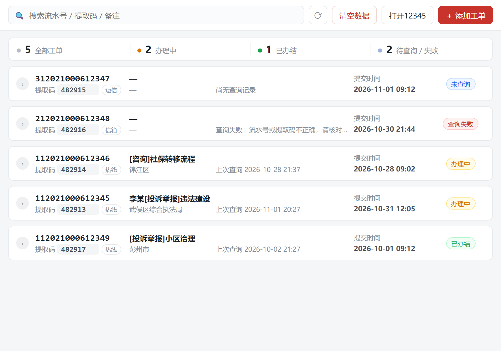
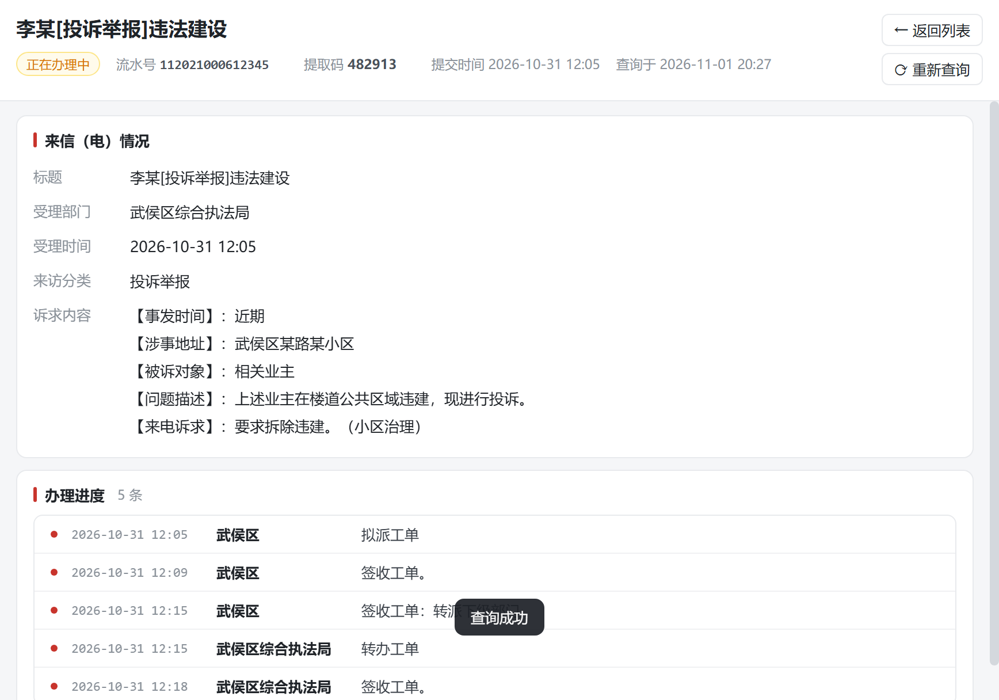
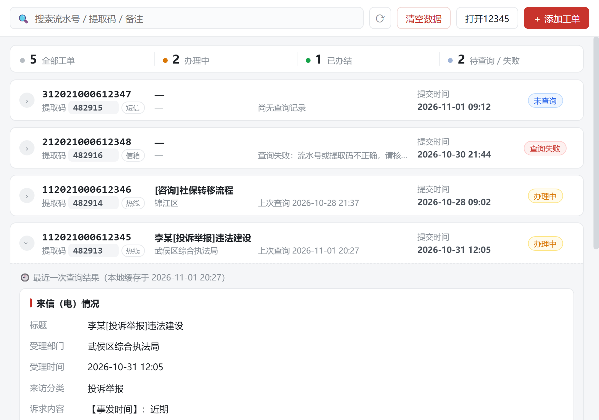
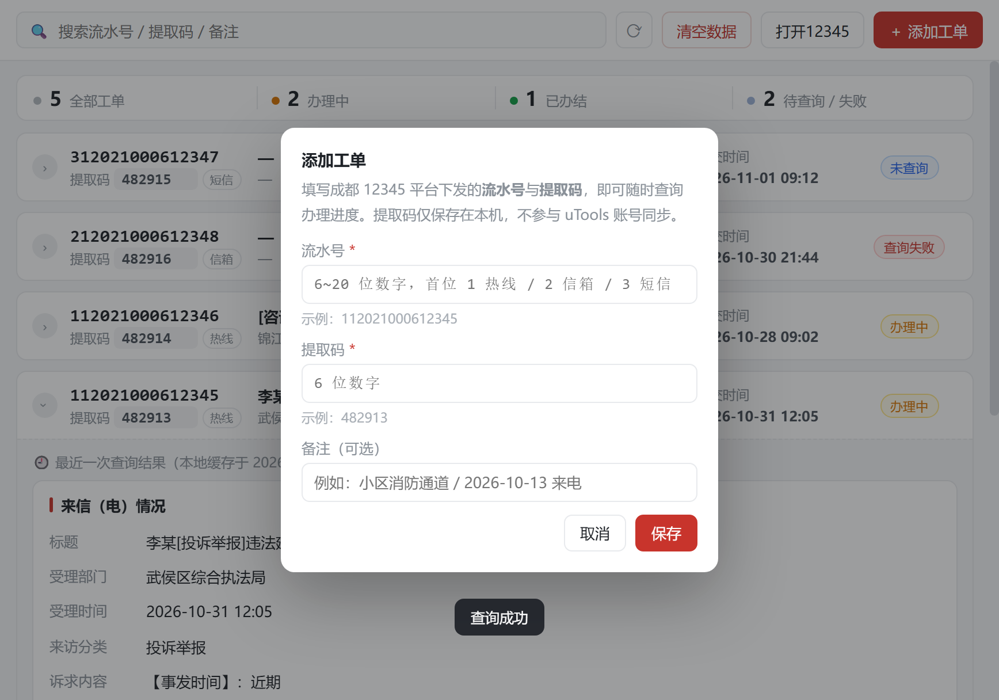
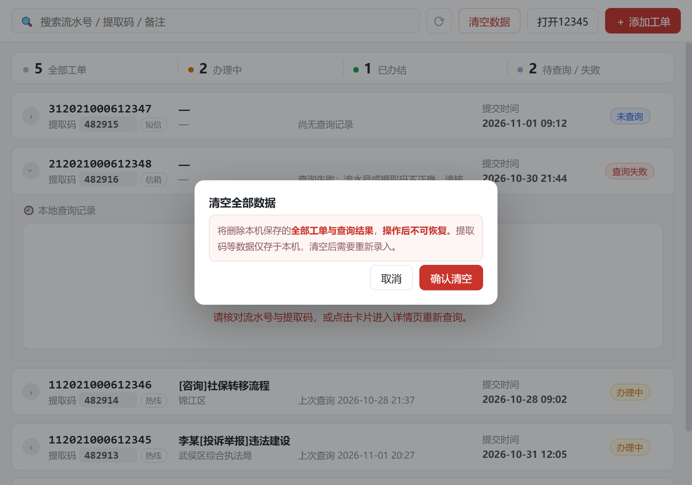
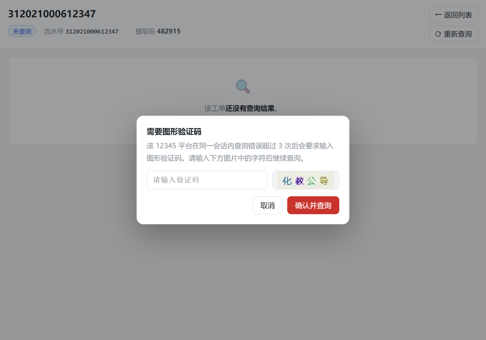

# 成都12345

> 在 uTools 中本地管理成都 12345 热线工单，随时查询办理进度。


成都 12345 热线工单的**本地查询助手**：把「流水号 + 提取码」存在本机，
点一下就能联网查询这张工单当前的**来电内容、承办部门、办理进度与办理结果**；
查询结果自动缓存，下次不联网也能翻看。

---

## 这是什么

一个**离线优先**的工单查询工具。

- 工单簿保存在本机，提取码**不参与** uTools 账号同步
- 只有你主动点「查询」时，才会带着凭据访问 `www.chengdu.gov.cn`
- 查询成功的结果写回本地，下次展开卡片即可直接看，不联网

## 功能

| | |
|---|---|
| **工单簿** | 本地保存「流水号 + 提取码」，支持备注、搜索，按提交时间倒序排列 |
| **一键查询** | 点击工单即联网查询，展示 来信（电）内容 / 承办部门 / 办理进度时间线 / 办理结果 |
| **结果缓存** | 查询成功后自动写回本地，列表页展开即可查看最近一次结果（与详情页同款布局），无需联网 |
| **三类工单** | 按流水号首位自动识别并分流：`1` 热线工单 · `2` 信箱工单 · `3` 短信工单 |
| **图形验证码** | 平台在同一会话内查询错误超过 3 次会要求验证码，插件在弹窗中处理 |
| **隐私** | 提取码等数据**仅保存在本机**，不参与账号同步 |

## 界面

| 列表页 | 详情页 |
|---|---|
|  |  |

| 展开最近一次结果 | 添加工单 |
|---|---|
|  |  |

| 清空数据（二次确认） | 图形验证码 |
|---|---|
|  |  |

## 使用

### 1. 添加工单

在 uTools 搜索框输入 `成都12345`（或 `cd12345`）进入插件，点右上角 **＋ 添加工单**：

| 字段 | 说明 |
|---|---|
| 流水号 | 12 位数字，首位 `1` 热线 / `2` 信箱 / `3` 短信 |
| 提取码 | 6 位数字 |
| 备注 | 选填，便于自己区分多张工单 |

流水号与提取码来自成都 12345 平台受理后下发的短信或来电回执。

### 2. 查询

- **点击卡片** → 进入详情页并自动联网查询（拿到最新结果）
- **点击左侧圆形箭头** → 展开卡片，只看本地缓存的最近一次结果（不联网），
  展开区与详情页**完全同款**：单栏逐项向下，依次是「来信（电）情况」「办理进度」「办理结果」
- **详情页右上角「⟳ 重新查询」** → 再次发起查询
- **详情页右上角「← 返回列表」** → 回到工单列表

### 3. 常用操作

| 操作 | 说明 |
|---|---|
| 点击**流水号 / 提取码** | 一键复制到剪贴板（列表页与详情页都支持，悬停出现复制图标） |
| 点击**办理进度**的任意一行 | 就地展开 / 收起完整内容 |
| 详情页右上角两个按钮 | 上下排列：**← 返回列表** / **⟳ 重新查询** |
| 工具条 **打开12345** | 在系统默认浏览器打开成都 12345 热线网站 |
| 工具条 **清空数据** | 删除本机保存的全部工单与查询结果（需二次确认，不可恢复） |

## 状态说明

| 徽章 | 含义 |
|---|---|
| 未查询 | 从未查询过，或还没有缓存结果 |
| 办理中 | 平台返回「正在办理中」等在办状态 |
| 已办结 | 平台返回办结结果 |
| 查询失败 | 上一次查询未成功，原因见展开面板 |

## 常见问题

**Q：查询一直提示「流水号或提取码不正确」？**
请先核对凭据。注意**信箱类工单（流水号首位 `2`）**、**热线工单（`1`）**、
**短信工单（`3`）**走的是平台的不同接口，插件已按首位自动分流。

**Q：提示要输入图形验证码？**
平台在同一会话内查询错误累计超过 3 次后会要求输入图形验证码，按弹窗提示输入即可；
若反复失败，重新进入插件再试一次（会重建会话）。

**Q：数据会同步到别的设备吗？**
不会。提取码等敏感信息只存本机，跨设备使用时需要重新录入。

**Q：查询很慢？**
首次查询需要与平台建立会话（约 2~4 秒），之后会复用会话，通常很快。

**Q：「打开12345」按钮能帮我填单号吗？**
不能，它只是用系统默认浏览器打开 12345 网站首页，不会带上任何凭据。

## 隐私与数据

- 工单数据（含提取码）保存在 uTools 为本插件分配的**本机目录**，不会上传任何服务器
- 只有在你主动点击「查询」时，插件才会带着凭据访问 `www.chengdu.gov.cn`；
  点「打开12345」只是用系统浏览器打开该网站的首页，不会带上任何凭据
- 提取码**不参与 uTools 账号同步**；跨设备使用时需要重新录入
- 卸载插件即彻底清除本地数据

---

## 开发

插件工程**就在仓库根目录**（uTools 开发者工具加载这一层）：

```
uTools-CD12345/
├── plugin.json       # 插件清单
├── logo.png          # 插件图标（太阳神鸟，全仓库唯一一份图标）
├── index.html        # 主界面（列表页 / 详情页，单页切换）
├── preload.js        # 桥接层 → window.services
├── bridge.html       # 风控会话窗口占位页
├── bridge-preload.js # 会话窗口 preload，剥离远程页面的 Node 能力
├── app/              # app.js / style.css（原生 JS，无构建）
├── libs/             # session.js / client.js / parser.js / store.js / util.js
├── README.md         # 本文件
├── docs/             # 仓库文档
│   ├── DESIGN.md     # 完整设计与实现说明
│   └── screenshots/  # 界面效果图
└── test/             # 回归测试与自测工具
    └── README.md     # 测试说明
```

- 运行环境：uTools 8.x（兼容 7.8.0）
- 无第三方依赖、无构建步骤，改完刷新插件即可生效
- 站点接口与风控会话的实现细节见 [`docs/DESIGN.md`](docs/DESIGN.md)

### 打包发布

发布到 uTools 开发者中心时**只打包运行时文件**（约 150 KB）：

```
plugin.json  logo.png  index.html  preload.js  bridge.html  bridge-preload.js
README.md  app/  libs/
```

`docs/` 与 `test/` 是仓库资产，**不要打进插件包**。在仓库根目录执行：

```powershell
Compress-Archive -Path plugin.json,logo.png,index.html,preload.js,bridge.html,bridge-preload.js,README.md,app,libs -DestinationPath cd12345.zip
```

### 自测

见 [`test/README.md`](test/README.md)。速览：

```bash
node test/test_store.js            # 存储层断言（19 项）
node test/test_store2.js           # 数据目录兜底 + 跨版本迁移
node test/test_parser4.js          # 四类真实页面解析回归
node test/test_align.js            # 列表状态列居中对齐实测
node test/test_align2.js           # 列表副标题两列左对齐实测
node test/test_captcha_session.js  # 验证码链路与会话连续性（需联网）
node test/e2e.js <流水号> <提取码>  # 真实凭据端到端（需联网）
node test/e2e-ubrowser.js          # uBrowser 兜底通道端到端（需联网）
node test/shoot-ui.js              # 重新生成 docs/screenshots/*.png
```

> 测试脚本**不内置任何凭据**，必须运行时传入（详见 `test/README.md`）。

---

数据来源：[成都市 12345 热线平台](https://www.chengdu.gov.cn/12345/index)

图标：[太阳神鸟金饰](https://www.jinshasitemuseum.com/)（成都城市形象标识，出土于金沙遗址）
