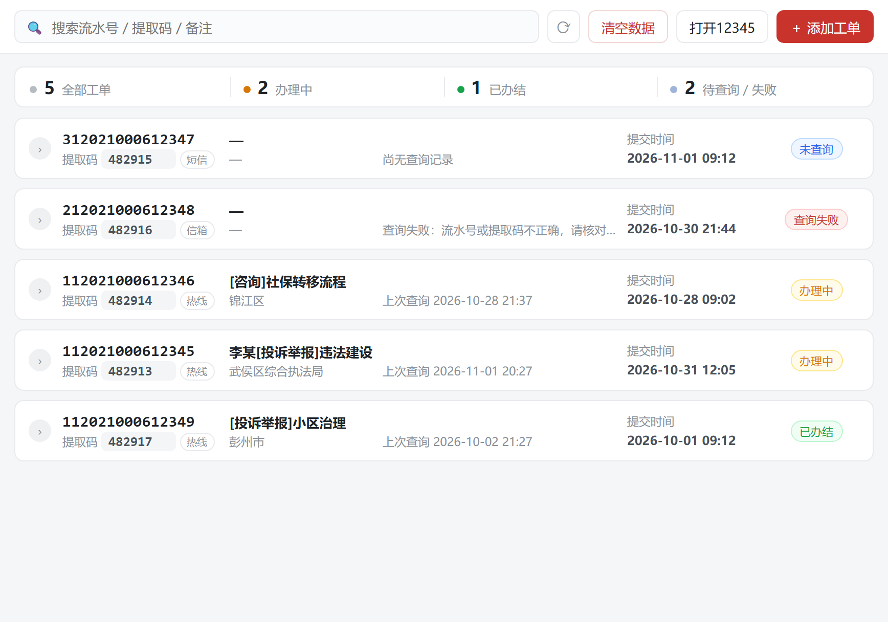
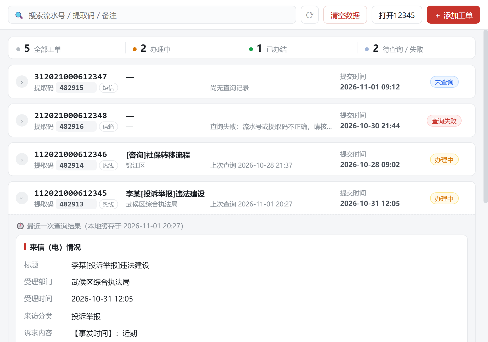
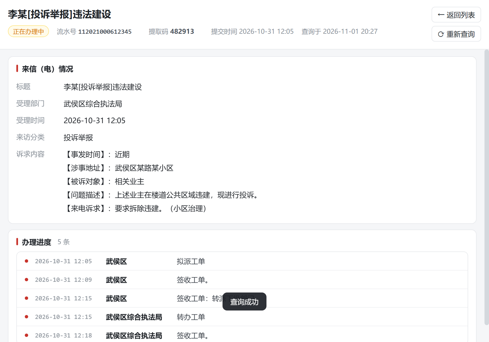
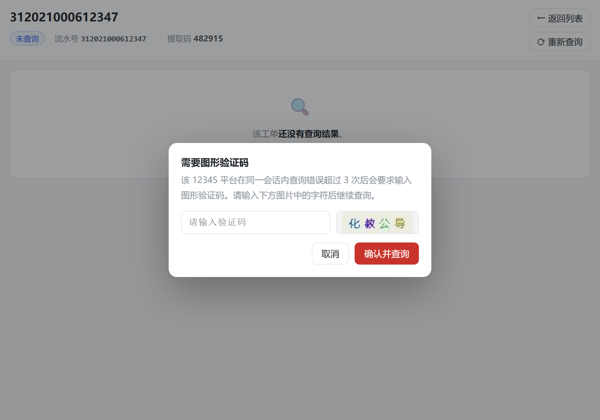
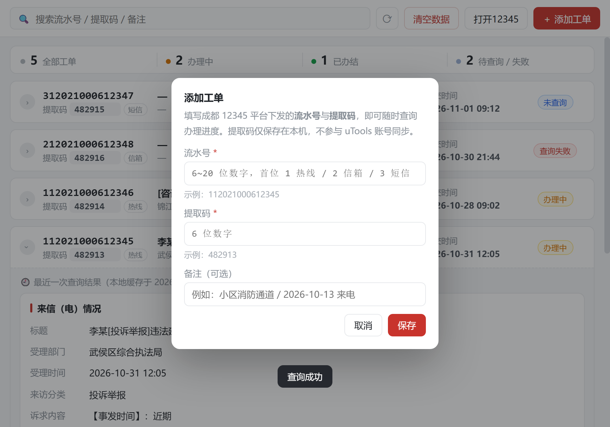
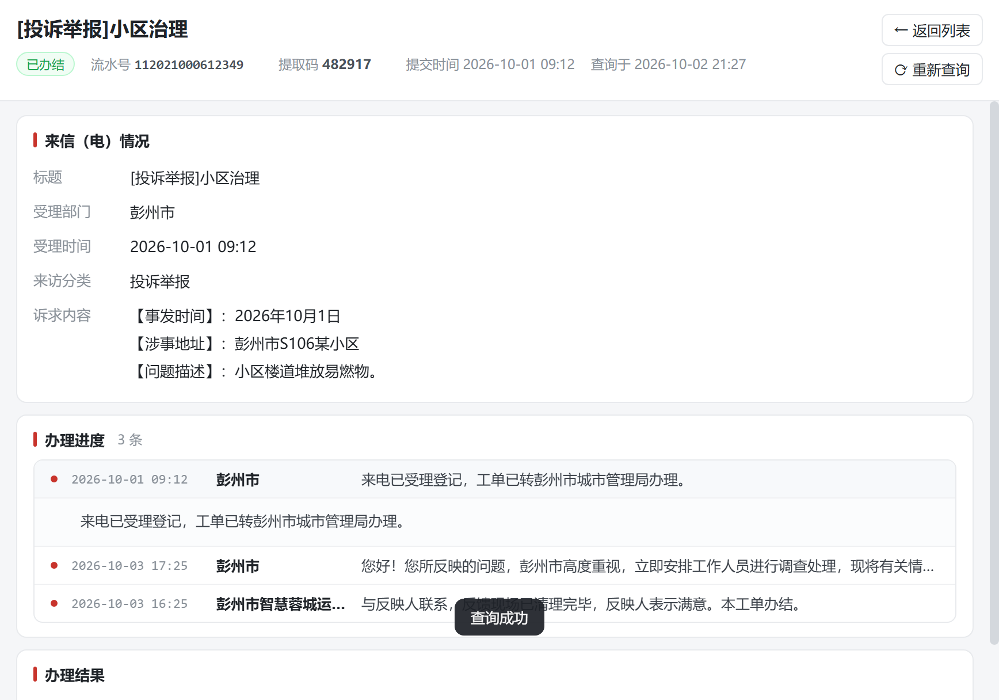
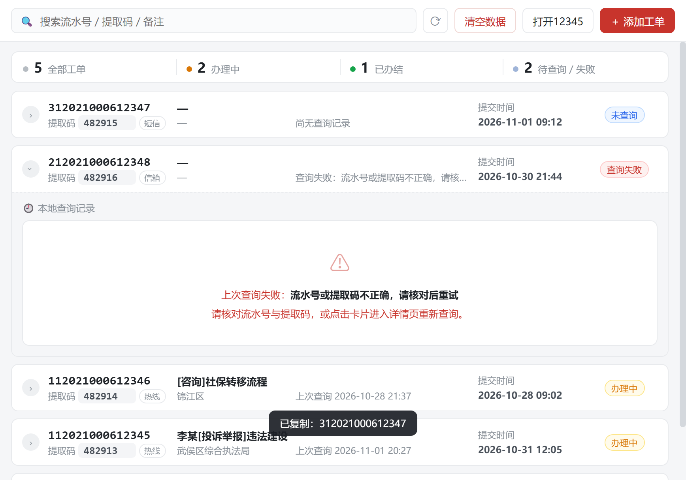
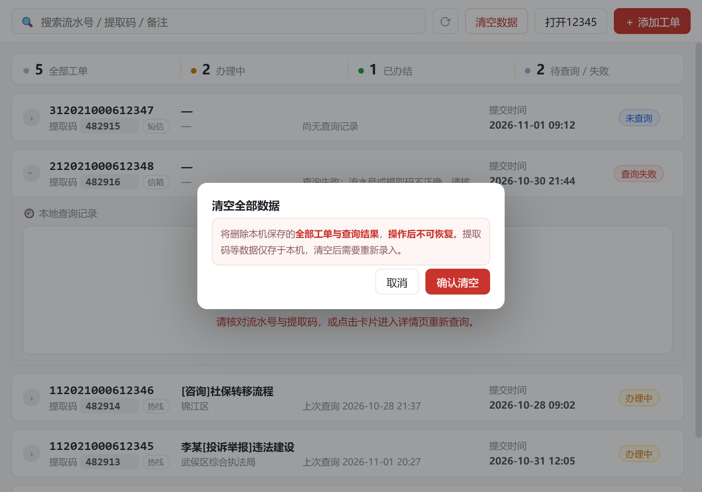
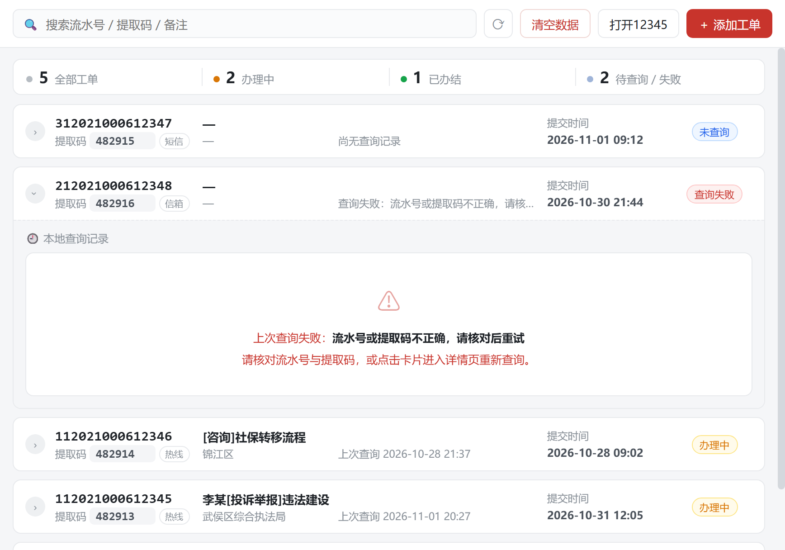

# 成都12345 · uTools 插件设计方案

> 版本 **v3.3** ｜ 状态：**已交付** ｜ 日期 2026-11-01
> v2.0 合入第一轮评审的 9 条决议；v2.1 修正列表列对齐；v2.2 列表按钮改为居中圆形按钮、图标重制为纯色标准圆的太阳神鸟；v2.3 完成编码并修正流水号长度校验规则；v2.4 用真实凭据联调成功，解析器按真实成功页结构重写为表格优先。

---

## 一、需求与决议对照

| 编号 | 需求 | 决议 | 落地位置 |
|---|---|---|---|
| R1 | 关键词唤起后自动显示「流水号 / 提取码」列表 | ✅ | 列表页 |
| R2 | 点击某条数据 → 自动调用接口查询工单完整内容 | ✅ | 详情页 + 在线查询 |
| R3 | 查询成功后写回该工单的「结果」字段 | ✅ | `ticket.result` 覆盖写 |
| R4 | 列表页可展开查看已缓存结果（不联网） | ✅ | 行内展开面板 |
| R5 | 不想联网时直接看历史结果 | ✅ | 展开面板只读展示 |
| **D1** | 流水号范围 | **全支持**（`1` 热线 / `2` 信箱 / `3` 短信） | 按首位自动分流接口 |
| **D10** | 流水号长度 | 宽松校验 6~20 位 | 依据站点 `Check.js` 实际规则修正 |
| **D11** | 办理进度排版 | **每条记录一行**，点击展开全文 | 5 条记录由一屏压缩到约 180px |
| **D12** | 插件自有 header | **移除**（与 uTools 自带标题栏重复），操作按钮并入工具条 | 省出 38px 垂直空间 |
| **D13** | 流水号 / 提取码 | **点击即复制到剪贴板**，并给出 toast 反馈 | 详情页头部 + 列表卡片提取码 |
| **D14** | 详情页高度优化 | 移除「来源」区块，「查询于」并入头部第二行；最后一个 section 去掉下边距 | 缩短整页滚动长度 |
| **D15** | 复制热区 | **只作用在数字上**，中文标签不参与 hover | 避免误以为「流水号」二字也可点 |
| **D16** | 危险操作说明 | 「清空全部数据」配说明文案 + tooltip + 二次确认 | 降低误删恐惧 |
| **D17** | 列表页底部提示 | **移除**「按来电时间倒序排列…」 | 减少噪音 |
| **D18** | 详情页头部 | 状态 / 流水号 / 提取码 / 来电时间 / 查询于 **并为一行** | 减少一行高度 |
| **D19** | 列表页状态列 | 徽章**在固定宽度列内居中** | 不同字数状态也严格对齐 |
| **D20** | 验证码图片 | 修复 uBrowser 通道下二进制被 UTF-8 破坏导致**图片渲染失败** | 改用 blob + FileReader 取 base64 |
| **D21** | 验证码校验 | 修复「验证码输入正确却提示不正确」 | 改用常驻自定义窗口作主通道（会话天然连续） |
| **D22** | 错误判定 | 修复「凭据正确却提示流水号/提取码不正确」 | 错误检测只看**可见文本**，不再全页正则 |
| **D23** | 信箱工单解析 | 补齐「来信情况」分节与「来 信人」等标签、一行两组 KV | 信箱类工单标题/时间/内容/进度正确解析 |
| **D37** | 列表页统计条样式粗糙 | 改为**单行分段摘要**：白底容器 + 4 段 + 细分隔线 + 语义色点 | 高度 80px → 38px；色点与状态徽章同色 |
| **D38** | 详情页 footer 占空间 | **移除 foot-bar**，「返回列表」「重新查询」移到头部右上角竖排 | 内容区多出一屏；文案统一为「← 返回列表」「⟳ 重新查询」 |
| **D34** | 展开区不该是横向两栏 | 改回**单栏纵向**，与详情页逐项向下 | 两处共用 `renderResultSections()` |
| **D35** | 列表页工单号不能复制 | 流水号也包一层 `.cpv`，点击复制 + hover 出 ⧉ | 与详情页一致 |
| **D36** | 工具条四个按钮样式零散 | 统一 `.tb-btn` 规格（同高 32px / 同圆角 / 同字号），用填充与配色分主次 | 主操作实心、危险红描边、次要描边、图标最轻 |
| **D30** | 列表副标题时间不成列 | 「部门」列固定宽 140px，「上次查询 时间」左对齐成列 | 实测偏差 0px |
| **D31** | 时间列文案不统一 | 「来电时间 / 填写时间」统一为「提交时间」 | 列表页与详情页同步 |
| **D32** | 「在浏览器打开」无实际价值 | 删掉两处按钮，工具条新增常驻「打开12345」 | 开站首页，不带凭据 |
| **D33** | 展开区与详情页割裂 | 展开区改用详情页同款样式，左右两栏铺开全部结果，移除底部按钮 | 展开区改为纯只读快照 |
| **D24** | 验证码自检 | `⋯` 面板新增「测试图形验证码」 | 凭据正确时也能独立验证取图→校验链路（**v3.5 起该入口已随 `⋯` 菜单一并移除**） |
| **D25** | 列表状态文案 | 「正在办理中」显示为「办理中」（详情页保留平台原文） | 徽章更紧凑 |
| **D26** | 标题完整文案 | 列表标题 / 展开面板加 `title` 属性 | 超长标题 hover 显示全文 |
| **D2** | 录入方式 | **仅「＋ 添加工单」表单** | 无批量导入 |
| **D3** | 提取码存储 | **存本地，不参与同步** | 本地 JSON，dbStorage 只存脱敏副本 |
| **D4** | 详情页形态 | **主窗口内切换 + 自动纵向滚动条** | 单页 SPA，详情区 `overflow-y:auto` |
| **D5** | 图形验证码 | **插件内弹窗输入** | 验证码弹窗 |
| **D6** | 结果保留 | **所有工单长期保留，但每条只保存最新一次查询结果** | `ticket.result` 单份覆盖 |
| **D7** | 插件图标 | **取自网站，提取最高清版本** | `logo.png`（256×256） |
| **D8** | 补充效果图 | 添加工单界面 / 从未查询过的展开界面 | `design/05`、`design/06` |
| **D9** | 列表增加时间并排序 | 增加「来电时间」（无则用填写时间），**按此倒序** | 列表排序规则 |

> 注：R3/R4/R5 的语义在 D6 下收敛为 —— **工单库永久保留，查询结果只有最新一份**。
> 所谓「历史结果」= 上一次成功查询的本地快照。

---

## 二、关键技术调研（已完成，含实测证据）

### 2.1 反爬现状

站点 `https://www.chengdu.gov.cn/12345/` 由**瑞数信息（Ruishu 5 代）**保护，
携带 `azSsQE5NvspcO` / `azSsQE5NvspcP` 两个动态 Cookie。

| 场景 | 结果 |
|---|---|
| Node / curl 直接 GET | **HTTP 412**，返回 `$_ts` 挑战脚本页 |
| 无头浏览器（headless） | 挑战 JS 执行后 **400**（被识别） |
| **有界面浏览器** | 412 → 挑战 JS → **200 正常页面** ✅ |
| 真实浏览器 UA（含 `Electron/30.0.0`） | **200 正常页面** ✅ |
| 拿到浏览器 Cookie 后用 **Node fetch** 直连接口 | **200 正常业务响应** ✅ |

> **核心结论**：瑞数 Cookie **不与 UA / TLS 指纹强绑定**。
> 插件只需「借一个真实 Chromium 窗口过一次性挑战」，之后请求即可轻量直连。

### 2.2 接口清单（已验证）

| 用途 | 方法 | 路径 | 参数 |
|---|---|---|---|
| 查询工单 | POST | `/12345/searchTelDealByWs` | `noMailorTel`、`noMailorTelPass`、`numcode=1`、`error=firstpageError`、（可选）`randCode001` |
| 信箱类 | POST | `/12345/searchMailDealByWs` | 流水号首位 `2` |
| 短信类 | POST | `/12345/searchMsgDealByWs` | 流水号首位 `3` |
| 工单详情 | GET | `/12345/searchMailDealReply?mailID=..&class=100&WorkFPkId=..` | 从结果页解析得到 |
| 验证码图 | GET | `/12345/Site/generateCode?numcode=1` | PNG |
| 校验验证码 | POST | `/12345/verifyCode` | `vCode`、`numcode` → `{status:"OK"}` |

**校验规则**（源自 `/12345/Site/js/Check.js` 的 `CheckMailorTel()`）：

- 提取码：6 位纯数字
- 流水号：纯数字，首位 `1/2/3`
  - 站点 `CheckTel()` 对**电话工单**要求恰好 12 位且首位为 `1`
  - 站点 `CheckMailorTel()`（首页「流水号/提取码」表单）只校验首位 `1/2/3`，
    **仅当首位为 `3`(短信) 时**才额外要求长度 12 位
  - 因此插件采取宽松校验（6~20 位纯数字 + 首位 1/2/3），真实长度以平台返回为准
- 同会话查询错误累计 **3 次**后需图形验证码（计数存 `JSESSIONID`）
- 失败文案固定：`提示：流水号或验证码错误！`

**响应特征**：页面编码为 **UTF-8**。

**两类页面的真实结构（v2.4 用真实凭据核对）**

| | 查询结果页 `searchTelDealByWs` | 办理公开页 `searchMailDealReply` |
|---|---|---|
| 容器 | `<table class="tb">` | `<table class="tb">` |
| 标题标签 | 来电标题 | 来信（电）标题 |
| 时间标签 | 来电时间 | 来信（电）时间 |
| 内容标签 | 来电内容 (`id=FmContent`) | 来信（电）内容 (`id=mailContent`) |
| 办理过程 | **办理情况** 段：每行 `处理部门 / 说明 / 处理时间 / 时间`（处理部门列 rowspan） | 无（只有办理部门名单） |
| 办理结果 | 单行状态文本，如 `正在办理中` | `id=DOverDesc` 回复正文，含多条 `部门(时间)：正文` |

> 真实样例（凭据 `112021000612345 / 482913`）：
> 标题「李某[投诉举报]违法建设」、来电时间 `2026-10-31 12:05`、
> 承办部门 `武侯区综合执法局`、状态 `正在办理中`、办理进度 5 条。

### 2.3 端到端验证记录

```
1) 无 Cookie  GET  /12345/index              → 412（瑞数挑战页）
2) 带 Cookie  POST /12345/searchTelDealByWs  → 200，含「流水号或验证码错误！」   ← 接口可达
3) 带 Cookie  GET  searchMailDealReply?...   → 200，含「办理结果」「来信（电）内容」 ← 详情可解析
4) 篡改 Cookie GET  /12345/index              → 412（挑战页）                     ← Cookie 确实生效
5) 换 UA     GET  详情页                       → 200 正常                          ← Cookie 不绑 UA
```

---

## 三、整体架构

```
┌──────────────────────────────────────────────────────────────┐
│  uTools 搜索框  「成都12345」→ 进入插件                        │
└──────────────────────────────────────────────────────────────┘
                          │
        ┌─────────────────▼──────────────────┐
        │  index.html（单页 SPA：列表页 ⇄ 详情页）│
        │  app.js + style.css（原生，无构建）      │
        └─────────────────▲──────────────────┘
                          │ window.services.*（preload 桥接）
        ┌─────────────────▼──────────────────┐
        │  preload.js                            │
        │   ├── store.js    工单库读写（本地 + 脱敏同步副本）│
        │   ├── session.js  瑞数会话（隐藏浏览器窗口）        │
        │   ├── client.js   接口客户端（query/detail/captcha）│
        │   └── parser.js   HTML → 结构化数据                │
        └─────────────────┬──────────────────┘
                          │ HTTPS
        ┌─────────────────▼──────────────────┐
        │  www.chengdu.gov.cn/12345/*            │
        └────────────────────────────────────────┘
```

### 3.1 会话层（`session.js`）—— 技术核心

> **v3.0 架构修订（最终形态）**
> v2.6 曾把 uBrowser 当作主通道；真实 uTools 联调后发现它有个致命缺陷：
> **`utools.ubrowser.run()` 结束会销毁隐藏窗口**，窗口一销毁，`JSESSIONID` 随之丢失。
> 而成都 12345 的图形验证码校验**要求 `JSESSIONID` 与验证码图属于同一个 HTTP 会话**——
> 于是出现「验证码输入正确却提示不正确」。
>
> 因此最终把主通道换成**常驻的自定义窗口**（`utools.createBrowserWindow`）：
> 窗口不销毁 ⇒ 瑞数 Cookie 与 `JSESSIONID` 都留在会话里 ⇒ 既免过盾，验证码也能正常校验。
> uBrowser 降为**备选通道**（自定义窗口不可用时兜底，此时验证码链路会失效）。
>
> **实测结论**
> | 方案 | 结论 |
> |---|---|
> | uTools 自定义窗口（常驻）+ 页面内 `location` 导航 | ✅ **主通道**：瑞数 Cookie 与 `JSESSIONID` 同时留存 |
> | uTools 自定义窗口 + `loadURL` | ❌ 运行时无此方法（文档有、实际没有） |
> | uBrowser（`utools.ubrowser`） | ⚠️ **备选**：`run()` 销毁窗口 ⇒ `JSESSIONID` 丢失，验证码不可用 |
> | 渲染进程自建 Electron BrowserWindow | ❌ `BrowserWindow is not a constructor` |
> | `setCookies` 搬运 Cookie 续会话 | ❌ 覆盖 httpOnly Cookie 被 Chromium 拒绝（`EXCLUDE_OVERWRITE_HTTP_ONLY`） |

**主通道**：常驻自定义窗口 + 页面内 `fetch`

```js
utools.createBrowserWindow("bridge.html", { show: false, /* … */ })
// 窗口内用 location 导航到目标页（因运行时无 loadURL）
win.webContents.executeJavaScript(`
  (async () => {
    const res = await fetch(URL, { credentials: "include", ...OPT });
    const buf = await res.arrayBuffer();
    return JSON.stringify({ status: res.status, url: res.url, b64: btoa(bin) });
  })()
`);
```

- 页面在 `https://www.chengdu.gov.cn/12345/index` 上下文里发请求 ⇒ 同源、Cookie 自动带上
- 二进制统一转 base64 回传，**绝不能走 `text()`**（UTF-8 解码会破坏 JPEG）
- 窗口挂 `bridge-preload.js`，剥离远程页面的 `require / process` 等 Node 能力

**备选通道**：uTools 官方 uBrowser

```js
utools.ubrowser
  .userAgent(UA)                                  // 7.x 无此方法 → 逐方法能力探测
  .goto("https://www.chengdu.gov.cn/12345/index")
  .wait(() => document.title.indexOf("成都12345") >= 0, { timeout: 30000 })
  .evaluate(fetchInPage, { url, method, headers, body })
  .wait(() => window.__cdResps[i].done, { timeout: 30000 })
  .evaluate(() => "__CD__" + JSON.stringify(window.__cdResps))
  .run({ show: false });
```

- 会话按插件隔离并**持久化 Cookie** → 瑞数挑战只需过一次
- 期望数量写在页面 `window.__cdExpect` 里，**不依赖 `wait()` 是否透传参数**
- 用 `__CD__` 标记定位返回值，避免受链式调用返回值顺序影响
- `run()` 结束后窗口销毁 ⇒ `JSESSIONID` 丢失 ⇒ 验证码链路不可用（故仅作兜底）

**兜底通道**：`utools.shellOpenExternal()` 引导到外部浏览器手动查询
（v3.6 起界面上的入口是工具条常驻按钮 **「打开12345」**；查询失败提示里也会建议用户手动查询）。

> 通道一旦抛错会自动降级。**v3.5 起界面不再暴露通道状态**（`⋯` 菜单已移除），
> 失败原因通过查询失败提示给出；会话失效时 `client.request()` 会自动
> `session.reset()` + 重试一次自愈。

**健康检查**：请求返回 412 或含 `$_ts` 特征 → 判定会话失效 → 重建窗口 → 重试 1 次 → 仍失败则提示用户。

### 3.2 数据模型（按 D6 收敛）

```ts
interface Ticket {
  id: string;                 // uuid
  serial: string;             // 流水号（6~20 位纯数字，首位 1/2/3）
  passcode: string;           // 提取码（6 位）——仅存本地
  kind: 'tel' | 'mail' | 'msg';
  remark?: string;            // 用户备注
  createdAt: number;          // 填写时间（新增工单时的时间戳）
  fillTime: string;           // 填写时间（可读）
  callTime?: string;          // 来电时间（查询成功后从页面解析得到）
  lastQueryAt?: number;
  queryState: 'never' | 'ok' | 'error';
  lastError?: string;

  // 仅保存最新一次查询结果（D6）
  result?: {
    queriedAt: number;
    statusText?: string;      // 已办结 / 办理中 ...
    summary: {                // 列表页展开时展示
      title?: string;
      category?: string;
      dept?: string;
      receiveTime?: string;
      appealContent?: string;
      appealant?: string;
    };
    timeline: { time?: string; dept?: string; text: string }[];   // 办理进度
    finalResult?: string;     // 办理结果
    rawHtml?: string;         // 原始快照（可选，默认不存）
  };
}
```

**排序规则（D9）**

```
sortKey = callTime ?? fillTime      // 来电时间优先，无则用填写时间
列表按 sortKey 倒序（新的在上）
```

**存储策略（D3）**

| 数据 | 位置 | 说明 |
|---|---|---|
| 工单全量（含提取码、结果） | 本地 `getPluginLocalDataPath()/tickets.json` | **提取码永不同步** |
| 脱敏副本（流水号、备注、时间、状态、摘要） | `utools.dbStorage` | 可跨设备；不含提取码与详情正文 |
| 原始 HTML 快照 | 本地 `snapshots/`（默认关闭） | 体积大、含个人信息 |
| 会话 Cookie | 不落盘，仅内存 | 安全 |

---

## 四、目录设计

插件工程**直接位于仓库根目录**（uTools 开发者工具加载这一层）。
`docs/` 与 `test/` 是仓库资产，**打包发布时不要包含**：

```
uTools-CD12345/                ← 仓库根 = 插件工程本体
├── plugin.json                 # main / logo / preload / features / cmds
├── logo.png                    # 256×256，太阳神鸟（见 §7）
├── index.html                  # 单页 SPA：列表页 + 详情页
├── preload.js                  # 桥接层，暴露 window.services
├── bridge.html                 # 风控会话窗口占位页
├── bridge-preload.js           # 会话窗口 preload，剥离远程页面的 Node 能力
├── app/
│   ├── app.js
│   └── style.css
├── libs/
│   ├── session.js              # 瑞数会话管理
│   ├── client.js               # 接口客户端
│   ├── parser.js               # HTML 解析
│   ├── store.js                # 工单库读写、排序、结果覆盖
│   └── util.js
├── README.md                   # 插件市场页文案 + 开发说明
├── docs/                       # 仓库文档（不随插件发布）
│   ├── DESIGN.md               # 本文档
│   └── screenshots/            # 界面效果图（README 引用）
│       ├── 01-list.png … 09-captcha.png
└── test/                       # 回归测试与自测工具（不随插件发布）
    ├── README.md               # 测试说明
    ├── uitest.html             # 前端自测页（内置桩服务）
    ├── shoot-ui.js             # 界面效果图生成器
    ├── ubrowser-mock.js        # uBrowser 模拟器
    ├── test_*.js e2e*.js       # 离线断言 + 真实凭据联调
    └── fixtures/               # 解析回归用的真实页面样本（已脱敏）
```

**发布包只含运行时文件**（约 150 KB）：

```
plugin.json  logo.png  index.html  preload.js  bridge.html  bridge-preload.js
README.md  app/  libs/
```

**`window.services` 接口**

```ts
window.services = {
  listTickets(): Promise<Ticket[]>            // 已按 sortKey 倒序
  addTicket({serial, passcode, remark}): Promise<Ticket[]>
  updateTicket(id, patch): Promise<Ticket[]>
  removeTicket(id): Promise<Ticket[]>
  queryTicket(id, opts?): Promise<{tickets, ticket}>   // 在线查询并回写
  getCaptcha(): Promise<{imageBase64, numcode}>         // 验证码图片
  openInBrowser(ticket): Promise<void>
}
```

---

## 五、核心流程

### 5.1 进入插件 → 列表页

```
onPluginEnter({code:'cd12345'})
  → listTickets()   → 按 sortKey 倒序 → 渲染卡片
  卡片展示：流水号 / 提取码 / 类型徽章 / 标题 / 部门 / 时间(来电或填写) / 状态徽章
```

### 5.2 展开卡片（v3.7 起：与详情页完全一致，单栏向下）

展开区**完全复用详情页的渲染函数与样式**（白色 section 卡片 + h4 标题 + 标签值行 + 时间线），
**单栏、逐项向下**，不再有任何操作按钮 —— 纯只读快照：

```
▸ 展开
🕘 最近一次查询结果（本地缓存于 …）
┌ 来信（电）情况 ─────────────────────────────────────────┐
│ 标题 / 诉求人 / 所属区域 / 受理部门 / 受理时间 / 来访分类  │
│ 诉求内容（全文）                                          │
└──────────────────────────────────────────────────────────┘
┌ 办理进度  N 条 ─────────────────────────────────────────┐
│ ● 2026-10-31 12:05 │ 武侯区 │ 拟派工单                    │
│ ● …                                                    │
└──────────────────────────────────────────────────────────┘
┌ 办理结果 ───────────────────────────────────────────────┐
└──────────────────────────────────────────────────────────┘
```

- **单栏纵向**，与详情页的 section 顺序、字号、行高完全一致
- 诉求内容**全文展示**（旧版截断 120 字）
- 时间线仍为「每条一行」，点击可就地展开全文
- 无 result 且有 lastError → 红色空态提示上次失败原因
- 从未查询过 → 空态提示「点击卡片进入详情页即可联网查询」

> 刷新最新结果的入口只有详情页（点击卡片主体进入 → 自动联网查询）。

**实现**：详情页与展开区调用**同一个** `renderResultSections(t)` 函数，
返回「来信（电）情况 + 办理进度 + 办理结果」三个 section 的 HTML 串，
因此两处内容与样式天然不会漂移。（v3.6 曾做成左右两栏，v3.7 按反馈改为单栏。）

### 5.3 点击卡片 → 详情页（D4）

```
点击卡片 → 主窗口内切换到详情视图（不新开窗口）
  ├─ 立即渲染缓存内容（若有）
  ├─ 详情区独立滚动容器（overflow-y:auto），内容超长时出现纵向滚动条
  ├─ 自动发起在线查询：顶部「正在查询…」进度条
  └─ session.ensure() → POST search*DealByWs → 解析结果页
       ├─ 收集 searchMailDealReply 链接
       ├─ 逐个 GET 详情 → 解析「来信情况 / 办理进度 / 办理结果」
       ├─ 覆盖写 ticket.result，刷新 callTime / summary / queryState
       └─ store.save() → 列表页对应卡片即时同步
```

### 5.4 失败与验证码

```
412                → 会话失效 → 重建 → 自动重试 1 次
「流水号或验证码错误！」→ 标记 error，详情页红条提示，不覆盖已有 result
需要图形验证码      → 弹窗（design/04）→ 输入 → POST verifyCode → 通过后带 randCode001 重试
```

---

## 六、界面设计（效果图）

以下截图均为**真实实现**的渲染结果（`docs/screenshots/`）

### 6.1 列表页（D9：时间列与状态列固定宽度对齐；D19：状态徽章列内居中；展开按钮改为居中圆形按钮；D12：移除插件自有 header；D30：「上次查询 时间」列左对齐成列；D31：时间列标签统一为「提交时间」；D37：统计条改为单行分段摘要）



### 6.2 展开看已缓存结果（D6：只有最新一次 · v3.7：与详情页同款单栏）



### 6.3 详情页（D4：主窗口内切换 + 纵向滚动；D11：办理进度一行一条；D13/D15：点击复制；D14/D18：头部瘦身并为一行；D38：移除 footer，操作按钮移到头部右上角竖排）



### 6.4 图形验证码弹窗（D5 / D20）

验证码图取自站点真实响应（`Site/generateCode`），渲染正常：



> **v3.0 修复**：uBrowser 通道原先用 `response.text()` 取响应体，
> 会把二进制（验证码 JPEG）按 UTF-8 解码后再编码，图片必然损坏成破图。
> 现改为 `response.blob()` + `FileReader` 直接取 base64，全程二进制无损。
> 自定义窗口通道原本就用 `btoa(bin)`，不受影响。


### 6.5 添加工单界面（D2 / D3）



要点：流水号（12 位，首位决定类型）、提取码（6 位）、备注（可选）；
弹窗内明示「提取码仅保存在本机，不参与 uTools 账号同步」；输入即时校验。

### 6.6 办理进度 · 一行一条（D11）

真实实现的紧凑排版 —— `● │ 时间 │ 部门 │ 说明`，全部行严格对齐：


点击任意一行就地展开完整正文（办结类工单的回复常有几百字，默认单行省略号截断，悬停出 tooltip）：



### 6.7 点击复制（D13 / D15）

详情页头部改为两行布局，省掉「来源」区块：

```
[正在办理中]   流水号 112021000612345 ⧉   提取码 482913 ⧉
来电时间 2026-10-31 12:05     查询于 2026-11-01 13:50
```

hover 与点击**只作用在数字上**（中文标签保持普通文本），数字悬停时出现 `⧉` 图标并高亮；
列表卡片里的提取码同样可点（不会触发打开详情）：



> 复制走 `utools.copyText()`（8.x 官方 API），不可用时回退 Electron `clipboard.writeText()`。

### 6.8 清空全部数据 · 二次确认（D16 / D27）



v3.4 时「更多菜单（⋯）」里还有三个区块：连接状态 / 验证码自检 / 清空全部数据。
**v3.5 起整个 `⋯` 菜单移除**：

- 「连接状态」「验证码自检」属于研发期诊断能力，生产环境不再暴露
  （会话失效由 `client.request()` 自动 `session.reset()` + 重试一次自愈，无需人工干预）
- 「清空全部数据」是唯一需要保留的功能 → 提升为**工具条上的常驻按钮**，点击后弹**二次确认**

工具条按钮用文字「清空数据」而非图标 —— 危险操作不用猜图标，
配合弱化的红色描边样式与 tooltip：

```
[ 搜索流水号 / 提取码 / 备注 ]  [⟳]  [清空数据]  [＋ 添加工单]
```

二次确认弹窗写清后果并提供「取消 / 确认清空」：

> 将删除本机保存的**全部工单与查询结果**，**操作后不可恢复**。
> 提取码等数据仅存于本机，清空后需要重新录入。

### 6.9 从未查询过的工单 · 展开态（D8-b）



要点：空态图标 + 「该工单**从未查询过**，暂无本地缓存结果」+ 唯一主操作【查询最新结果】；
与「查询失败」态区分（后者展示具体失败原因与【重新查询】）。

---

## 七、插件图标（D7 · v2.2 修订）

**最终采用：成都「太阳神鸟」金饰 —— 纯色版，标准正圆，高清透明 PNG。**

### 7.1 选图过程

| 候选 | 尺寸 | 结论 |
|---|---|---|
| `/12345/Site/img/favicon.ico` | 16×16 | ❌ 站点 favicon 仅 16px，不可用 |
| `/12345/Site/img/logo.png` | 480×70 | ❌ 是「成都12345热线平台」文字标，不是太阳神鸟（留作字标备用） |
| `/12345/Site/img/logo_logo.png` | 75×75 | ❌ 是**国徽**，涉《国徽法》使用规范 |
| `chengdu.gov.cn` 首页 `home_gh.png` / `logo0427.png` | 121×139 / 331×192 | ❌ 同样是国徽 |
| 金沙遗址博物馆官网文物图 | 4256×2832 RGBA | ⚠️ 高清但是**实物照片**（带金箔纹理、非纯色、非标准圆） |
| **花瓣网纯色矢量图（用户指定）** | 658×658 | ✅ **采用为图形底稿** |

### 7.2 重制处理

基于用户指定的 658×658 纯色底稿，**不是简单缩放，而是重新渲染成高分辨率矢量级图形**：

1. **求标准圆**：由黄色区域外接框定位圆心 `(328.0, 327.5)`、半径 `296.5`，
   以解析式重建正圆（`|p−C| ≤ R`），边缘用有符号距离做 1px 抗锯齿；
   实测渲染后外沿半径方差为 0，**圆度 100%**。
2. **求纯色**：统计全部黄色像素中位色 → 单一色值 `#EBB400` (235,180,0)。
   实测输出 PNG **仅含 1 种颜色**，无渐变、无杂色。
3. **镂空飞鸟**：实测原图 `0.90R ~ R` 的外环为 100% 实心（飞鸟图案全部内缩在内圈），
   因此在内圈 `r < 0.90R` 内按源图白色度做双线性采样并**挖空为透明**，
   圆外亦全透明 —— 背景色无关，浅色/深色主题下都成立。
4. **高清重建**：在 1024×1024 上以解析圆 + 双线性重采样重绘（非位图放大），
   再 LANCZOS 降采样出 512 / 256，边缘锐利无锯齿。

### 7.3 产出

| 文件 | 尺寸 | 用途 |
|---|---|---|
| `logo.png` | 256×256 | **插件图标**（`plugin.json` 的 `logo` 与 `features[].icon`） |


> 制作过程中用过 1024 母版、512 备用、白色版、站点字标等多份中间产物，
> 以及金沙遗址博物馆的文物原图；这些**都不是运行时资源**，v3.9 已全部从仓库清除，
> 只保留最终成品 `logo.png` 一份（与 `plugin.json` 引用的完全一致）。

> 太阳神鸟金饰为金沙遗址出土文物，属公有领域图像；成都市将其用于城市形象标识，
> 本插件作为本地查询工具使用，无授权风险。

---

## 八、异常与边界处理

| 场景 | 处理 |
|---|---|
| 瑞数会话失效（412） | 自动重建隐藏窗口 → 重试 1 次 → 仍失败提示用户 |
| 流水号/提取码错误 | 详情页红条提示；**不覆盖**已有缓存结果 |
| 需要图形验证码 | 弹验证码图 → 输入 → 校验 → 重试 |
| 网络超时/断网 | 友好提示 + 保留缓存可读 |
| 站点改版致解析失败 | parser 多策略匹配 + 兜底取原文；解析失败不破坏缓存 |
| 同一工单重复点击 | 请求去重（同一 id 并发只发一次） |
| 频繁请求 | 串行队列 + 最小间隔（1.5s），避免风控 |
| 提取码安全 | 默认本地存储 + 不同步 + 一键清除；日志不写明文 |
| 列表过长 | 列表区独立滚动 + 时间倒序定位 |

---

## 九、执行步骤

| 阶段 | 内容 | 预估 |
|---|---|---|
| **P0** | 插件骨架：`plugin.json`、`logo.png`、`index.html`、`preload.js` 空壳，可被 uTools 加载调试 | 0.5h |
| **P1** | 数据层：`store.js` + 工单增删改查 + 添加工单表单 + 按时间倒序 | 1.5h |
| **P2** | 会话层：`session.js` 隐藏窗口过瑞数、健康检查、失效重建 | 2h |
| **P3** | 接口层：`client.js`（三类查询分流 / 详情 / 验证码） | 1.5h |
| **P4** | 解析层：`parser.js`（结果页 + 详情页 → 结构化） | 2h |
| **P5** | 详情页：主窗口内切换 + 独立滚动容器 + 结果覆盖回写 + 展开面板 | 2h |
| **P6** | 健壮性：验证码弹窗、错误分类、重试、去重、限速 | 1.5h |
| **P7** | 打包发布：开发者中心上传、README、图标、真实凭据联调 | 1.5h |

> 合计约 **12.5 小时**。建议 **P0 → P2 优先合流**（先跑通「能查通」），再补 UI 与健壮性。

**执行状态（v3.4）**：P0 ~ P7 **全部完成**。
真实凭据联调通过、界面按 D1~D26 全部落地、生产化清理完成，进入发布阶段。

---

## 十、风险与备选

| 风险 | 影响 | 备选 |
|---|---|---|
| 瑞数升级、隐藏窗口被判定 | 查询失败 | 降级到 uBrowser 备选通道（瑞数 Cookie 仍在）；或引导外部浏览器人工查询 |
| uTools 限制隐藏窗口加载远程站点 | 无法过瑞数 | 策略 B（自建 BrowserWindow）→ 策略 C（外部浏览器引导） |
| 站点改版 / 接口改名 | 解析失效 | parser 按语义标签多策略提取 + 原文兜底；解析失败不破坏缓存 |
| 接口被官方关闭 | 完全不可用 | 退化为「本地工单簿 + 手动录入结果」 |
| 提取码泄露 | 安全问题 | 默认本地存储不同步 + 一键清除 + 日志脱敏；会话窗口挂 `bridge-preload.js`，远程页面拿不到 Node 能力 |
| 站点改版致 `webPreferences.preload` 失效 | 查询失败 | 建窗流程 4 步递进降级（见 §3.1 / v3.4），最终退回不带 preload 的窗口 |

---

## 十一、仍需确认（已全部解决）

| # | 原问题 | 结论 |
|---|---|---|
| 1 | 需要一组**真实流水号 + 提取码**才能验证成功分支 | ✅ 已解决：热线 `112021000612345/482913`、信箱 `212021000612348/482916` 等真实凭据全部查询成功（v2.4 / v3.x） |
| 2 | 列表页在 uTools 主窗口中的初始高度 | ✅ 采用 `pluginSetting.height = 560`，详情页滚动区自适应 |

发布前剩余动作：把**运行时文件**打成 zip 上传 uTools 开发者中心
（见根目录 `README.md` 的「打包发布」一节），并填写插件市场页文案。

---

## 十一·补、运行环境版本适配（v2.7）

### 现象

用户在 **uTools 7.8.0** 上运行，uBrowser 通道不可用：

```
[cd12345/session] uBrowser 通道失败，降级到备选通道: utools.ubrowser.userAgent is not a function
[cd12345/session] utools-hidden 导航方式: location
[cd12345/session] 会话就绪: utools-hidden      ← 备选通道成功，查询正常
```

### 根因：文档是 8.x 的

查阅 [uTools 更新日志](https://www.u-tools.cn/changelog/)：

| | uTools 7.8.0（2026-04-14） | uTools 8.0.0（2026-10-13） |
|---|---|---|
| Electron | 23 | **34.5.8** |
| Chromium | 108 | **132** |
| Node.js | 16 | **20** |
| 新增开发 API | — | **`utools.getPluginLocalDataPath`**、`utools.getPluginTempPath`、`utools.getSchedules` |

> **官方文档基于 8.x 编写**，因此出现「文档有、运行时没有」的情况：
> `createBrowserWindow().loadURL`、`uBrowser.userAgent` 等都是 8.x 形态。

### 由此带来的三个适配点（v2.7 已全部处理）

| # | 问题 | 处理 |
|---|---|---|
| 1 | 7.x 上 `uBrowser` 方法集不完整 | **逐方法能力探测**（`ubrowserCaps()`），缺 `userAgent`/`wait` 就跳过对应步骤；核心三件套 `goto/evaluate/run` 齐备才启用 |
| 2 | 7.x 上 `utools.getPluginLocalDataPath` **不存在**（8.0.0 才新增） | **存储目录多级兜底**：① `getPluginLocalDataPath()` ② `getPath('home')/.uTools-CD12345` ③ 系统临时目录 |
| 3 | 升级 uTools 后数据目录会变 | **自动迁移**：新目录没有数据文件时，自动从旧候选目录复制过来（`store.readAll()`） |

### 建议

- **建议升级到 8.0.2**：uBrowser 通道可用 → Cookie 持久化 → **每次查询免过瑞数**（省 2~4 秒）；
  `createBrowserWindow.loadURL` 也可用。
- 升级不会丢数据：本插件已实现跨目录迁移；且工单数据本身只是「流水号 + 提取码」，即使丢失也可重新录入。
- 不升级也能正常使用：备选通道（自定义窗口 + 页面内导航）已在 7.8.0 实测验证通过，
  唯一代价是每次查询都要重新过一次瑞数挑战。
- 插件右上角 `⋯` 会显示**当前数据目录**与**连接通道**，方便排查。
  （**v3.5 起 `⋯` 菜单已整体移除**，这些诊断信息不再对外暴露。）

### v3.4：生产化收尾（发布前）

#### 1. 移除研发期残留

| 移除项 | 位置 | 说明 |
|---|---|---|
| `session.setTransport()` | `libs/session.js` | 注入传输层的调试钩子，生产无意义；离线测试改为直接覆写 `session.fetchInPage` |
| `session.probeWindow()` / `describeWindow()` | `libs/session.js` | 窗口能力探测，仅用于早期定位 uTools API 差异 |
| `preload.envInfo()` / `preload.probeWindow()` | `preload.js` | 同上 |
| `preload.dataDir()` | `preload.js` | 数据目录「排查用」展示；界面已改为「连接状态：正常/异常」，不再暴露本机路径 |
| `state.env` / `refreshDataDir()` | `app/app.js` | 对应的前端死代码 |
| 「输出窗口能力」按钮、环境/数据目录行 | `app/app.js` | `⋯` 面板只保留「连接状态 / 验证码自检 / 清空全部数据」 |

> 保留：`⋯ → 测试图形验证码`（D24）、`session.sessionStatus()`（界面显示连接状态）。
> —— **⚠️ 上述两项已在 v3.5 随 `⋯` 菜单整体移除**，详见 v3.5。

#### 2. 补上 `bridge-preload.js`（原本是孤儿文件）

会话窗口会被导航到 `www.chengdu.gov.cn` 远程页面，`webPreferences.preload` 此前**从未被设置**，
`bridge-preload.js` 形同虚设。现按 uTools 官方文档补齐：

```js
opts.webPreferences = { preload: "bridge-preload.js" };
```

`bridge-preload.js` 在页面脚本运行前剥离 `require / module / process / global / Buffer`，
避免远程页面在插件进程里拿到本机文件访问能力。

**兼容降级**：`session.js` 的建窗流程改为 4 步递进，任意一步成功即返回：

| # | 窗口 | preload | 超时 |
|---|---|---|---|
| 1 | 屏幕内 | ✅ | 30s |
| 2 | 离屏 | ✅ | 15s |
| 3 | 屏幕内 | ❌ | 30s |
| 4 | 离屏 | ❌ | 15s |

- 第 1 步「建窗抛异常」⇒ 判定为该 uTools 版本不接受 `webPreferences.preload` ⇒ 跳到第 3 步；
- 第 1 步「窗口建起来了但页面没就绪」⇒ 判定为站点风控 ⇒ 继续往下试；
- 带 preload 的尝试用较短超时（失败多半是环境不支持，不是站点慢），避免用户干等。

#### 3. 目录重组

原先插件工程直接铺在仓库根，研发资料与可发布代码混在一起，容易误打包。
现拆为 `plugin/`（工程本体）与 `dev/`（研发资料）两层，**发布只打 `plugin/`**。
（**⚠️ v3.5 起插件工程又上提回仓库根目录**，v3.9 再把研发资料拆为 `docs/` 与 `test/`，
见 v3.5 与 v3.9。）

> ⚠️ uTools 开发者工具的「插件目录」需重新指向 `E:\workspace\uTools-CD12345\plugin`。

#### 4. 回归测试

| 脚本 | 覆盖 | 结果 |
|---|---|---|
| `test/test_store.js` | 存储层 19 项断言 | 全通过 |
| `test/test_store2.js` | 数据目录兜底 + 跨版本迁移 | 通过 |
| `test/test_parser4.js` | 四类真实页面解析回归 | 通过 |
| `test/test_align.js` | 列表状态徽章列内居中 | 偏差 `0.00px` |
| `test/test_align2.js` | 列表副标题两列左对齐（「上次查询 时间」成列） | 偏差 `0px` |
| `test/test_captcha_session.js` | 验证码链路（重写，见下） | 全通过 |
| `test/e2e.js <流水号> <提取码>` | 真实凭据端到端 | 通过 |
| `test/e2e-ubrowser.js` | uBrowser 兜底通道端到端 | 通过 |

`test/test_captcha_session.js` 在 v3.4 被重写：旧版断言的是已被废弃的
「把 Cookie 搬到新窗口续会话」机制（`session.savedCookies()` 已删除）。
新版改为断言**当前架构真正依赖的性质**：

1. 验证码图接口返回合法 JPEG；
2. **取图 → 校验之间 `JSESSIONID` 不变**（这正是主通道「常驻窗口」的意义所在）；
3. 错误验证码被服务端拒绝（`status:"-1"`），而不是返回 HTML 错误页；
4. 二次取图仍可用。

---

### v3.9：仓库结构收敛 + 资产清理（发布前最后一步）

准备为根目录建 git 仓库，顺势把结构彻底收敛一遍。

#### 1. `assets/` 整个删除

盘了一遍引用，发现 `assets/` 里的 5 个文件**没有一个在运行时被用到**：

| 文件 | 引用情况 | 处置 |
|---|---|---|
| `assets/logo.png` | 只被 README 引用，且与根目录 `logo.png` **字节完全相同**（MD5 一致） | 删除，README 改引用根 `logo.png` |
| `assets/logo-1024.png` | 无引用（制作母版） | 删除 |
| `assets/logo-512.png` | 无引用（备用尺寸） | 删除 |
| `assets/logo-white.png` | 无引用（深色背景用） | 删除 |
| `assets/logo-wordmark-480x70.png` | 无引用（站点字标，且不是太阳神鸟） | 删除 |

`plugin.json` 的 `logo` 与 `features[].icon` 指向的都是根目录的 `logo.png`，
所以运行时不依赖 `assets/`。**全仓库只保留 `logo.png` 一份图标。**

顺带的收益：`assets/` 占了 251 KB，占发布包 406 KB 的 **62%**；
删掉后发布包从 406 KB 降到 **约 150 KB**。

#### 2. 目录结构：`dev/` 拆成 `docs/` + `test/`

原来的 `dev/` 是个大杂烩（370 个文件 / 18.7 MB），里面混着四类完全不同的东西：

| 原来的内容 | 体积 | 处置 |
|---|---|---|
| `scratch/`（175 个一次性 patch 脚本） | 952 KB | **删除** |
| `research/`（逆向脚本 + 站点样本 + 4.3 MB 文物原图） | 12.7 MB | **删除** |
| `docs/` `docs_txt/`（存档的 uTools 官网页面） | 1.8 MB | **删除** |
| `design/`（早期原型 mockup + 6 张设计稿） | 1.2 MB | **删除**（已被真实截图取代） |
| `DESIGN.md` | 73 KB | → `docs/DESIGN.md` |
| `ui-*.png`（9 张真实效果图） | 1.9 MB | → `docs/screenshots/`（去掉 `ui-` 前缀，改为 `01-list.png` 式编号） |
| 测试脚本 + `uitest.html` | 60 KB | → `test/` |

最终结构：

```
├── plugin.json  logo.png  index.html  preload.js  bridge.html  bridge-preload.js
├── app/            前端（app.js / style.css）
├── libs/           session / client / parser / store / util
├── README.md       插件市场页文案 + 开发说明
├── docs/
│   ├── DESIGN.md       设计与实现文档
│   └── screenshots/    界面效果图（README 与 DESIGN 共用）
└── test/              回归测试与自测工具（不随插件发布）
    ├── README.md
    ├── uitest.html  shoot-ui.js  ubrowser-mock.js
    ├── test_*.js  e2e*.js
    └── fixtures/      真实页面样本（已脱敏）
```

**为什么截图放 `docs/screenshots/` 而不是 `assets/`**：
截图是**文档资产**不是运行时资源。放进 `assets/` 会让它们随插件包一起发布（多 1.9 MB），
而且语义也不对 —— `assets/` 装的是插件运行时用的东西。

#### 3. 隐私处理（因为仓库可能要公开）

两处**绝对不能进公开仓库**的东西：

1. **真实凭据**：`e2e.js` / `e2e-ubrowser.js` 原本硬编码了默认的流水号 + 提取码。
   改为**必须运行时传入**（命令行参数或 `CD12345_SERIAL` / `CD12345_PASSCODE` 环境变量），
   缺参数时打印用法并退出。
2. **真实投诉人信息**：解析回归用的 4 个页面样本是平台真实返回页，
   含姓名、住址、门牌号（如「李某」「某路某小区 4 栋 1 单元 301、302 号业主」）。
   入库前统一脱敏：

   | 原 | 脱敏后 |
   |---|---|
   | 李某 / 王某 / 张某 | 李某 / 王某 / 张某 |
   | 某小区 / 某小区 / 某社区 | 某小区 / 某小区 / 某社区 |
   | 某路 | 某路 |
   | 4 栋 1 单元 301、302 号业主 | 相关业主 |
   | 反映人 / 来电人 | 反映人 |

   脱敏后解析回归仍全部通过（`test/test_parser4.js` 四类样本解析结果与之前一致）。

#### 4. 界面效果图脱敏

`docs/screenshots/*.png` 是**从 `test/uitest.html` 生成的**，
所以脱敏的正确做法不是去改像素，而是**改源头再重新生成**：

| 位置 | 内容 | 脱敏方式 |
|---|---|---|
| `test/uitest.html` | 5 组工单凭据 | 全部换成 `1120210006123xx` / `4829xx` 一类的**连续演示号**（一眼可辨不是真实凭据） |
| `test/uitest.html` | 投诉人姓名 | 换成「李某 / 王某 / 张某」 |
| `test/uitest.html` | 住址与门牌 | 换成「武侯区某路某小区」「相关业主」 |
| `test/uitest.html` | 办理回复正文 | 社区名 / 小区名 → 「某社区 / 某小区」；数量 → 「若干」；对来电人的称谓 → 「反映人」 |
| `libs/parser.js` | 注释里的解析示例 | 同上 |
| `docs/DESIGN.md` | 历史记录里粘贴的真实输出 | 同上 |
| `test/test_store*.js` | 测试用凭据 | 同上 |
| `test/fixtures/*.html` | 真实页面样本 | 同上（文件名里的流水号也一并改掉） |

> 本文档**刻意不列出脱敏前的原值** —— 那等于把要脱敏的东西又写了一遍。
> 需要追溯原始取证记录时，git 历史里能找到（但如果仓库要公开，
> 建议在首次提交前就把历史一起清掉，或全程用合成数据开发）。

脱敏后重新生成 9 张截图，并对**全部文本文件 + PNG 二进制**做了一遍扫描，
确认不再出现任何真实流水号 / 提取码 / 姓名 / 住址。

#### 5. 新增 `.gitignore`

忽略 `node_modules/`、`dist/`、`*.zip`、编辑器目录、系统文件、日志等。
本插件零依赖零构建，实际用到的规则不多，但留着以防将来引入工具链。

### v3.8：统计条重做 + 详情页去 footer

#### 1. 列表页统计条重做（D37）

旧版是 4 个独立白卡片，大号数字（19px）在上、标签在下，各占约 80px 高；
数字用**内联 `style="color:…"`** 着色，且颜色语义与状态徽章对不上
（徽章里「办理中」是琥珀色，统计条里却是红色）。

v3.8 改为**单行分段摘要**：

```
┌──────────────────────────────────────────────────────────────────┐
│ ● 5 全部工单   │ ● 2 办理中   │ ● 1 已办结   │ ● 2 待查询 / 失败 │
└──────────────────────────────────────────────────────────────────┘
```

| 改动 | 说明 |
|---|---|
| 4 卡 → 1 容器 4 段 | 段间用 1px 细分隔线，整体高度 80px → **38px** |
| 数字 + 标签同行 | 数字 17px 粗体在前、12px 灰标签在后，一眼扫完 |
| 色点代替内联色 | 用 `.dot` 圆点承载语义色，颜色可随徽章一起调 |
| 颜色对齐徽章 | 办理中 → 琥珀 `--wait`、已办结 → 绿 `--ok`、待查询/失败 → 灰蓝（混合态，取中性色） |

配色语义统一后，列表页的统计条与右侧状态徽章说的是同一种颜色语言。

#### 2. 详情页移除 foot-bar（D38）

旧版详情页底部有一条常驻 `foot-bar`：「← 返回列表」+ 说明文字 +「重新查询最新」。
它把内容区压矮了一截（工具条本身约 44px），而这里放的是**两个可以放在头部**的操作。

v3.8 移除整条 footer，两个按钮移到**详情页头部右上角、上下两行竖排**：

```
┌──────────────────────────────────────────────────────────────┐
│ 李某[投诉举报]违法建设                        ┌────────────┐ │
│ 正在办理中  流水号 …  提取码 …  提交时间 …       │ ← 返回列表  │ │
│                                               │ ⟳ 重新查询  │ │
│                                               └────────────┘ │
├──────────────────────────────────────────────────────────────┤
│ 来信（电）情况 / 办理进度 / 办理结果 …（内容区一直到底）        │
└──────────────────────────────────────────────────────────────┘
```

按钮文案与样式统一考虑：

| | 旧 | 新 | 理由 |
|---|---|---|---|
| 返回 | `← 返回列表`（footer 内的文字链） | `← 返回列表`（描边按钮） | 与「重新查询」同一形态，不再一个链一个钮 |
| 查询 | `重新查询最新`（实心主按钮） | `⟳ 重新查询`（描边按钮） | 「最新」二字的语义已由头部「查询于 …」承载；加 ⟳ 图标与工具条刷新按钮呼应；与「返回列表」同为 4 字，两按钮等宽 |

- 两个按钮统一 `.d-btn`：同高 28px、同圆角 6px、同字号 12.5px、同描边样式，**仅靠图标区分**
- 都是「次要操作」，因此不做实心强调 —— 实心红只留给全 app 唯一的主操作「＋ 添加工单」
- 顺带删掉了 `.foot-bar` / `.back` / `.note` 三段 CSS，以及 footer 里那句
  「结果为最近一次查询快照，列表页展开即可查看」—— 头部已有「查询于 …」，信息重复

结构上，`.detail-head` 变成 flex 布局：左侧 `.d-main`（标题 + 元信息），右侧 `.d-actions`（竖排按钮组）。

### v3.7：展开区改单栏 + 列表流水号可复制 + 工具条按钮统一

#### 1. 展开区改回单栏（D34 · 修正 v3.6）

v3.6 把列表页展开区做成了**左右两栏**（来信情况 | 办理进度）。反馈是：展开区应该
**和详情页一样逐项往下显示**，单栏即可。

改动：

- 删除 `.expand-cols` / `.exp-col` / `.tl-list.compact` 相关样式
- 展开区直接输出 `renderResultSections(t)`，与详情页**共用同一个渲染函数**：

```js
/** 「结果区」——来信（电）情况 + 办理进度 + 办理结果 */
function renderResultSections(t) { … }
```

- 详情页与展开区因此在内容、顺序、字号、行高上**完全一致**，不存在样式漂移

展开区当前结构（单栏向下）：

```
🕘 最近一次查询结果（本地缓存于 …）
┌ 来信（电）情况 ─────────────────────────────┐
┌ 办理进度  N 条 ─────────────────────────────┐
┌ 办理结果 ───────────────────────────────────┐
```

#### 2. 列表页流水号支持点击复制（D35）

之前只有「提取码」可点复制，流水号是纯文本。现在卡片的流水号也包一层 `.cpv`：

```js
'<div class="serial"><b class="cpv mono" data-act="copy" data-text="' + esc(t.serial) +
'" title="点击复制流水号">' + esc(t.serial) + '<i class="cp-ico">⧉</i></b></div>'
```

- 复用已有的 `.cpv` / `.cp-ico` 组件：hover 出现 ⧉ 图标、点击复制并 toast「已复制：…」
- `.serial .cpv { font-weight: 700; color: inherit; }` —— 保持流水号原本的粗体深色，
  不因复用 `.cpv` 而变灰变细
- 点击命中判定无风险：`closest("[data-act]")` 取到的是最近的 `.cpv`（`data-act="copy"`），
  不会触发卡片的 `data-act="open"` 进入详情页

#### 3. 工具条四个按钮统一规格 + 分级（D36）

原来四个按钮是四种样式（`.icon-btn` 裸图标 / `.btn sm danger-ghost` / `.btn` / `.btn`），
高矮胖瘦不一、主次不明。统一为 `.tb-btn`：

```css
.tb-btn {
  height: 32px; flex: none; padding: 0 12px;
  border: 1px solid var(--line); border-radius: 7px; background: #fff;
  font-size: 13px; color: var(--text);
  display: inline-flex; align-items: center; justify-content: center; gap: 4px;
}
```

同一规格（同高 32px / 同圆角 7px / 同字号 13px / 同边框），靠**填充与配色**分主次：

| 按钮 | 变体 | 视觉 | 意图 |
|---|---|---|---|
| ⟳ 刷新 | `.tb-icon` | 32×32 方钮，灰色图标 | 次要中的最轻，纯图标即可识别 |
| 清空数据 | `.tb-danger` | 红色文字 + 浅红描边 | 危险操作：一眼可辨，但不像主按钮那样抢眼 |
| 打开12345 | 默认 | 深色文字 + 灰描边 | 普通次要操作 |
| ＋ 添加工单 | `.tb-primary` | 实心强调色，白字 | 主操作，放最右 |

顺序也做了考量：**清空数据**与主按钮之间隔着「打开12345」，两个红色不挨着，避免歧义。

顺带删掉了两条已无引用的 CSS：`.icon-btn`（刷新按钮改用 `.tb-btn.tb-icon`）、
`.btn.link`（`⋯` 面板移除后无使用点）。

### v3.6：列表页信息密度优化

#### 1. 「上次查询 时间」左对齐成列（D30）

卡片副标题原本是「部门 · 上次查询 时间」拼成的一整串字符串，
**部门名长度不同 ⇒ 「上次查询」的起始位置随行漂移**，时间无法成列（见 §6.1 标注区）。

改为 grid 两列：

```css
.t-sub {
  display: grid;
  grid-template-columns: 140px minmax(0, 1fr);  /* 部门列固定宽 */
  gap: 10px; align-items: baseline;
}
.t-dept, .t-qtime { overflow: hidden; text-overflow: ellipsis; white-space: nowrap; }
```

- 部门列固定 140px ⇒ 「上次查询 时间」列的左边缘在所有行完全一致
- 部门名超长时省略并保留 `title` 悬浮提示

实测（`test/test_align2.js`，无头浏览器量坐标）：

```
查询列左边缘最大偏差 : 0 px ✅ 完全对齐
部门列左边缘最大偏差 : 0 px ✅ 完全对齐
```

#### 2. 「来电时间」→「提交时间」（D31）

列表页时间列原为「来电时间」（有平台来电时间时）/「填写时间」（否则）两套文案，
统一改为 **「提交时间」** —— 两者表达的都是「这张工单提交到 12345 平台的时间」，
列头固定一个文案更稳。详情页头部元信息同步改名。

#### 3. 移除「在浏览器打开」，改为工具条「打开12345」（D32）

原来的「在浏览器打开」按钮开的是 12345 网站首页，**并不能自动带上流水号和提取码**，
对用户没有实际价值（还得手动再填一遍），故：

- **删除** 列表页展开区的「在浏览器打开 ↗」按钮
- **删除** 详情页 footer 的「在浏览器打开」按钮
- **新增** 列表页工具条常驻按钮 **「打开12345」** → `utools.shellOpenExternal()`
  直接用系统默认浏览器打开 12345 热线网站首页

```
[ 搜索流水号 / 提取码 / 备注 ]  [⟳]  [清空数据]  [打开12345]  [＋ 添加工单]
```

#### 4. 展开区改为详情页同款（D33 · **v3.7 修正为单栏**）

展开区原本是**另一套**简化样式（灰底 KV 列表 + 诉求内容截断 120 字 + 底部三个操作按钮），
与详情页割裂，且看不到办理进度与办理结果。v3.6 先做成左右两栏，
**v3.7 按反馈改为单栏纵向**（与详情页逐项向下），详见 v3.7。v3.6 确立的目标保留不变：

- 复用详情页的 section 卡片样式（白底 + h4 标题 + 标签值行 + 时间线）
- **单栏纵向**（v3.6 曾为左右两栏，v3.7 改回单栏）：依次「来信（电）情况」→「办理进度」→「办理结果」
- 诉求内容**全文展示**，办理进度与办理结果**全部铺开**
- **移除底部全部操作按钮**（查询最新结果 / 查看完整详情 / 在浏览器打开）
  —— 展开区定位为**只读快照**；要刷新最新数据，点卡片主体进详情页（自动联网查询）

代码上抽出三个共用函数，详情页与展开区共用同一套渲染，避免两处样式漂移：

| 函数 | 作用 |
|---|---|
| `summaryFields(sm)` | 「来信（电）情况」的字段清单 |
| `renderFields(fields)` | 标签值行渲染 |
| `renderTimeline(t, timeline)` | 办理进度时间线（含点击展开全文） |

配套样式：`.tl-time` 补 `overflow:hidden` 防止长时间戳溢出压住部门列。
（v3.6 的 `.expand-cols` / `.tl-list.compact` 已在 v3.7 随单栏方案一并删除。）

> **列表页展开区因此变成纯只读**。这与「点击工单进入详情页 → 自动查询最新数据」的
> 主流程不冲突：展开看的是**上一次**的结果，详情页看的是**最新**的结果。

### v3.5：界面瘦身与目录扁平化（发布前最后一轮）

#### 1. 移除「⋯」更多菜单

v3.4 时 `⋯` 面板里有三块内容。v3.5 起**整个菜单按钮被移除**：

| 原内容 | 处置 | 理由 |
|---|---|---|
| 连接状态（正常/异常 + 重新建立连接） | **移除** | 会话失效时 `client.request()` 会自动 `session.reset()` + 重试一次，已能自愈；生产环境无需暴露内部通道概念 |
| 验证码自检（测试图形验证码） | **移除** | 研发期自检入口。`client.getCaptcha()` / `verifyCaptcha()` 本身保留，正式查询触发验证码时仍会用 |
| 清空全部数据 | **提升为工具条按钮** | 唯一需要保留的功能 |

同步清理的代码：

- `app/app.js`：删除 `more` / `captcha-test` 两个弹窗分支、`more` / `captcha-test` / `verify-test`
  三个事件分支、`refreshSession()` / `refreshConnection()` 两个函数
- `preload.js`：删除 `sessionKind()` / `sessionStatus()` / `resetSession()`，以及对 `libs/session` 的引用
  （`libs/session.js` 自身导出的 `kind()` / `status()` 保留，属模块 API）
- `app/style.css`：删除 `.d-top`、合并重复的 `.back:hover`

> ⚠️ 副作用：手动「重新建立连接」的入口没有了。若日后遇到会话反复失效，
> 重新进入插件即可（`session.ensure()` 会重建窗口）。

#### 2. 详情页头部瘦身（D28）

原先详情页顶部有 `.d-top` 行（`← 返回列表` + `⋯`）。v3.5：

- **`.d-top` 整行移除** —— 详情页顶部只剩「标题 + 元信息一行」

```
┌──────────────────────────────────────────────┐
│ 李某[投诉举报]违法建设        ┌────────────┐  │
│ 正在办理中  流水号 …  提取码 …  │ ← 返回列表  │  │
│                               │ ⟳ 重新查询  │  │
├──────────────────────────────────────────────┤
│ 来信（电）情况 / 办理进度 / 办理结果 …          │  ← 独立纵向滚动区
└──────────────────────────────────────────────┘
```

> v3.5 时「← 返回列表」在 footer 最左侧；**v3.8 已整条移除 footer**，
> 两个按钮移到头部右上角竖排（见 v3.8）。

footer 里的「返回列表」用 `.back` 弱化样式，`note` 加 `ellipsis` 防止窄窗口挤压按钮。

#### 3. 清空数据改为工具条按钮 + 二次确认（D27）

- 工具条：`[搜索] [⟳] [清空数据] [＋ 添加工单]`
- 「清空数据」用 **文字按钮 + 弱化红色描边**（`.btn.danger-ghost`），而不是图标 ——
  危险操作不需要猜图标；tooltip 补充完整后果
- 点击后弹出**二次确认弹窗**（`state.dialog === "clear"`），
  写清「删除全部工单与查询结果 / 不可恢复 / 需重新录入提取码」，
  按钮为「取消」（默认）与「确认清空」（`.btn.danger-solid` 实心红）
- 列表为空时点击直接 toast「暂无数据可清空」，不弹窗
- 原本用的 `window.confirm()` 换成应用内弹窗：样式统一，且能写清楚后果

#### 4. 目录扁平化（D29）

插件工程从 `plugin/` 子目录**上提到仓库根目录**：

- uTools 开发者工具加载路径改为 **仓库根目录**（不再是 `plugin/`）
- 测试脚本里的 `require("../plugin/libs/…")` 改为 `require("../libs/…")`，
  `uitest.html` 的 `../plugin/app/…` 改为 `../app/…`
- 打包发布时**排除 `dev/`**（约 18 MB 研发资料）；实际发布体积 19 个文件 / 0.4 MB
- 顺带清掉一个误入仓库的 Edge 用户配置目录（约 17 MB 垃圾）
- **v3.9**：`dev/` 进一步拆为 `docs/`（文档与截图）与 `test/`（测试与自测工具）

#### 5. 效果图脚本同步

`test/shoot-ui.js` 跟随界面调整：

- `06-more` → `06-clear-confirm`（打开「清空数据」确认弹窗）
- 删除 `10-captcha-test`（自检弹窗已移除）

### v3.3：三处体验改进

| # | 需求 | 实现 |
|---|---|---|
| D24 | 凭据正确时无法复现验证码流程 | `⋯` 面板新增「**测试图形验证码**」：直接向站点取一张真实验证码图并弹窗，输入后调用 `verifyCode` 校验，toast 提示「校验通过 ✓」/「校验未通过 ✗」。**完全不依赖工单凭据**，可随时自检取图→校验链路 |
| D25 | 列表状态「正在办理中」太长 | `statusInfo(t, compact)` 增加紧凑模式：列表页（卡片徽章、统计）显示「办理中」，**详情页与展开面板保留平台原文**「正在办理中」 |
| D26 | 长标题显示不完 | 卡片标题与展开面板加 `title` 属性，鼠标悬停显示完整文案（原生 tooltip，不受卡片 `overflow:hidden` 裁剪影响） |


### v3.2：「凭据正确却提示流水号或提取码不正确」的根因与修复

**现象**：凭据在网站上明明能查出结果，插件却报「查询失败：流水号或提取码不正确」。

**取证**（当时的 `dev/research/fp_probe.js`，真实凭据打真实站点；该一次性脚本已在 v3.9 清理）：

```
响应长度: 27928
  含「流水号或验证码错误」: 否
  含「提取码错误」: 是（位置 27639）
      上下文: …else{ alert("流水号或提取码错误"); return false; } …
```

**根因**：结果页里内联着站点自己的**前端校验脚本**，其中一句是
`alert("流水号或提取码错误")`。而解析器的错误检测用的是**全页正则**
`/提取码错误|验证码错误|…/`，把这段 **JS 字面量**当成了服务端返回的错误。

- 为什么热线工单没暴露？热线表单的校验脚本在外部 `Check.js` 里，不在结果页内联；
  而**信箱工单（流水号首位 `2`）的结果页恰好内联了这段脚本** → 必中。
- 为什么接口没问题？用同一组凭据直接打站点，三个接口都返回 200 且**不含**错误提示，
  说明凭据与接口路由都是对的，纯粹是前端误判。

**修复**

| 层 | 做法 |
|---|---|
| `libs/parser.js` | 新增 `visibleText()`：剥离 `script`/`style` 后再取文本；`detectError()` / `detectStatus()` 一律只扫可见文本 |
| `libs/parser.js` | 补齐信箱页的标签与结构（见 D23），使信箱工单也能正确解析 |

**顺带修正的会话通道**

日志里还有一条：

```
[setCookies] Failed to set cookie - The cookie would have overwritten an HttpOnly cookie,
and was not allowed to do so. EXCLUDE_OVERWRITE_HTTP_ONLY
```

Chromium 不允许用 `setCookies` 覆盖已存在的 httpOnly Cookie（瑞数那两个正是 httpOnly），
于是 v3.1 的「搬运 Cookie 续会话」方案会把整条 uBrowser 通道打断。

**结论与重构**：真正能同时满足「免过盾」和「验证码可用」的通道是
**常驻的自定义窗口**（窗口不销毁 ⇒ 瑞数 Cookie 与 JSESSIONID 都在它的会话里）。
因此 v3.2 把通道顺序调整为：

1. **主通道：常驻自定义窗口**（`utools.createBrowserWindow` + 页面内 `location` 导航）
   —— 一次过盾，全程复用，会话连续
2. **备选通道：uBrowser** —— 只在自定义窗口不可用时兜底
   （其 `run()` 会销毁窗口 ⇒ JSESSIONID 丢失 ⇒ 验证码不可用，故不再作为主通道）

同时移除了 Cookie 搬运逻辑，避免再次触发 `EXCLUDE_OVERWRITE_HTTP_ONLY`；
并修正了 `session.ensure()` 的语义 —— 只有 uBrowser 通道可用时也应视为「就绪」，
否则调用方会直接判失败（现已加入 `windowUnavailable` 标记，窗口创建失败后不再反复尝试）。

**验证**（真实凭据 `212021000612348 / 482916`，信箱类工单）：

```
[3] 查询耗时 279 ms
[4] 标题     : 武侯区某路某小区大门口路面公共停车位取消事宜
    来电时间 : 2026-04-15 21:28
    承办部门 : 市交管局
    状态     : 已办结
    办理进度 : 12 条
      [0] 武侯区 | 2026-04-15 21:56 | 拟派工单
      [1] 武侯区 | 2026-04-16 10:38 | 签收工单
      …
[5] queryState: ok | callTime: 2026-04-15 21:28
```

### v3.1：「验证码输入正确却提示不正确」的根因与修复

**现象**：验证码图片正常显示，用户输入正确字符，点「确认并查询」仍提示「验证码不正确」。

**实测取证**（当时的 `dev/research/vc_probe.js`，直接打真实站点；该一次性脚本已在 v3.9 清理）：

```
A 取验证码: {"status":200,"bytes":1107}
A 的 JSESSIONID: DC7D1B0E012A…
A 校验(错误码，有验证码会话): 200 | {"status":"-1"}
B 的 JSESSIONID: 1CFF391FE5EE…          ← 独立上下文，会话不同
B 校验(错误码，无验证码会话): 200 | {"status":"-1"}
=> 两次响应完全相同（服务端无法区分「验证码错」与「会话里没有验证码」）
```

**根因链条**

1. 验证码由 `Site/generateCode?numcode=1` 下发，服务端把它存进**当前 HTTP 会话**；
2. 校验接口 `verifyCode` 从**当前会话**取出来比对；
3. 两者的唯一纽带是 **`JSESSIONID`（会话 Cookie）**；
4. uBrowser 每次 `run()` 结束都会销毁隐藏窗口 → **会话 Cookie 随之丢失**；
5. 于是「取验证码」与「校验验证码」落在**两个不同的会话**里，
   服务端在第二个会话中根本找不到那张验证码 → 无论输入什么都返回 `{"status":"-1"}`。

> 站点自身不会踩这个坑：它在**同一次页面加载**内完成取图与校验。

**修复**

| 层 | 做法 |
|---|---|
| `libs/session.js` | 每次 uBrowser 请求结束后用 `.cookies({domain:'chengdu.gov.cn'})` **采集会话 Cookie** 并记在内存；下一轮请求前先用 `.setCookies(...)` **恢复**再发请求 |
| `libs/client.js` | 校验失败时自动切换到「自定义窗口」通道（该通道窗口常驻，会话天然连续），并重新取图让用户再输一次 |
| `libs/app.js` | 提示文案改为「校验未通过，请重新输入验证码」（服务端不区分原因，原文案会误导用户） |
| `⋯` 面板 | 运行环境新增「会话 N 个 Cookie」，便于确认会话是否保持（**v3.5 起 `⋯` 已移除**） |

**验证**（`test/test_captcha_session.js`，模拟「窗口销毁 → 会话 Cookie 丢失」）：

```
[1] 第一次请求（取验证码）…  状态 200 | 字节 1167 | JPEG头 true
[2] 插件记住的 Cookie: ariauseGraymode,azSsQE5NvspcO,JSESSIONID,azSsQE5NvspcP
[3] 模拟「窗口销毁 → 会话 Cookie 丢失」… 清空后 JSESSIONID: (无) ✅ 已丢失
[4] 第二次请求（应自动恢复会话后再发）… 请求后 JSESSIONID: 8EEB7D964293FF5E…
    与记住的是否一致: ✅ 一致（会话已恢复）
会话连续性测试通过 ✅ —— 验证码可在下一轮正常校验
```

### v3.0：三处修正

| # | 问题 | 原因 | 修复 |
|---|---|---|---|
| 1 | 详情页头部占两行 | 「来电时间 / 查询于」被拆到独立的 `.d-sub` 行 | 合并进 `.d-meta`，用 `flex-wrap` 兜底；时间类字段用小号灰字（`.dim`）区分层级 |
| 2 | 状态列徽章未对齐 | `.col-status` 用 `justify-content:flex-start`，字数不同则左边缘齐、右侧参差 | 改为 `justify-content:center`，列宽固定 84px。**实测 3/4/5 字徽章相对列中心偏移均为 0.00px**（`test/test_align.js`） |
| 3 | **验证码图片渲染失败** | uBrowser 通道用 `response.text()` 读响应体，JPEG 被 UTF-8 解码破坏 | 改用 `response.blob()` + `FileReader` 取 base64；二进制全程无损。实测 JPEG 首尾标记（`FFD8` / `FFD9`）齐全 |

### v2.9：新版 API 是否被优先采用？

**是。** 代码里所有与 uTools 版本相关的分支都是「**先试新 API，失败再降级**」：

| 能力 | 优先使用 | 降级 |
|---|---|---|
| 风控会话 | `utools.ubrowser`（8.x，Cookie 持久化，查询免过瑞数） | `utools.createBrowserWindow` + 页面内 `location` 导航（7.x） |
| 插件数据目录 | `utools.getPluginLocalDataPath()`（8.0.0+，官方插件专属目录） | `utools.getPath('home')/.uTools-CD12345` → 系统临时目录 |
| 剪贴板 | `utools.copyText()`（8.x 官方 API） | Electron `clipboard.writeText()` |

实现方式：
- `ubrowserCaps()` —— 逐方法探测 `utools.ubrowser` 的方法集，缺哪个跳过哪个；
  只有核心三件套 `goto / evaluate / run` 齐备才启用 uBrowser，否则整体走备选通道
- `candidateDirs()` —— 目录按优先级依次尝试，命中即用；**读数据时若当前目录为空，
  自动从其它候选目录迁移**（升级 uTools 目录变化也不丢数据）
- `copyText()` —— `utools.copyText` 存在就用，否则 Electron 剪贴板

> **兼容分支的运行时代价为零**：新版环境下旧分支根本不会执行。
> 若决定只支持 8.x，把 `libs/session.js` 的 `tryOpen("utools-hidden"…)` 一行去掉、
> `candidateDirs()` 缩成一档即可，代码能再瘦一半 —— 但那样 7.x 用户就完全不能用，
> 目前的做法是「保留兼容、不增加复杂度」。

### v2.8：升级到 8.0.2 后是否要改代码？

**不需要改，且建议保留对 7.x 的兼容。** 理由：

1. 代码本身已经是「**按能力探测 + 多级降级**」的结构，不含任何版本判断：
   - `ubrowserCaps()` 逐方法探测 → 8.x 走 uBrowser 快通道，7.x 自动降级
   - 存储目录三级兜底 + 跨版本自动迁移 → 升级后目录变化也能找到旧数据
2. 兼容层几乎零成本（几行 `if`），却让插件能覆盖 7.x 用户；
3. uTools 的 API 变动是持续发生的，能力探测比硬编码版本号更耐用。

升级后可在 `⋯` 面板确认状态（**v3.5 起 `⋯` 面板已移除，此处仅作历史记录**）：

| 显示项 | 8.0.2 预期 | 7.8.0 预期 |
|---|---|---|
| Electron | 34.5.8 | 23.x |
| Node | 20.19.1 | 16.x |
| 插件数据目录 API | ✓ | ✗（用兜底目录 `~/.uTools-CD12345`） |
| uBrowser | ✓ | ✗（用自定义窗口通道） |
| 连接状态 | 已就绪（ubrowser） | 已就绪（utools-hidden） |

---

## 十二、编码实现（v2.3 已完成）

### 交付的插件工程

见 §四 的目录树。**插件工程就在仓库根目录**，uTools 开发者工具直接加载这一层；
打包发布时只打包**运行时文件**（§四 末尾的清单，约 150 KB），
排除 `docs/` 与 `test/`（仓库资产，约 2 MB）。

### 已完成的验证

| 验证项 | 方式 | 结果 |
|---|---|---|
| 存储层 | `node test/test_store.js` | 19 项断言全通过（增删改查 / 类型推导 / 去重 / 排序 / 结果覆盖 / 失败不覆盖 / 同步脱敏） |
| 解析层 | `node test/test_parser4.js` | 四类真实页面样本（热线 / 信箱 / 办理公开 / 错误页）解析出标题、受理时间、诉求内容、办理部门、状态、办理进度，并正确识别错误页 |
| 错误识别 | 同上 | 正确识别「流水号或验证码错误」并归一化为友好提示 |
| 前端 | `test/uitest.html` + 无头浏览器截图 | 列表 / 展开 / 详情 / 添加工单 / 错误态 5 个界面状态渲染正确 |
| 语法 | `node --check` | 8 个 JS 文件全部通过 |

### v2.4 真实凭据联调（已通过）

用真实流水号 + 提取码跑通 `client.js → parser.js → store.js` 全链路：

```
[1] 瑞数挑战通过，页面标题: "成都12345热线"
[2] 新增工单: OK
[3] 查询耗时 205 ms
[4] 解析结果:
    标题     : 李某[投诉举报]违法建设
    来电时间 : 2026-10-31 12:05
    承办部门 : 武侯区综合执法局
    分类     : 投诉举报
    状态     : 正在办理中
    办理进度 : 5 条
      [0] 武侯区 | 2026-10-31 12:05 | 拟派工单
      [1] 武侯区 | 2026-10-31 12:09 | 签收工单。
      [2] 武侯区 | 2026-10-31 12:15 | 签收工单：转派下级部门
      [3] 武侯区综合执法局 | 2026-10-31 12:15 | 转办工单
      [4] 武侯区综合执法局 | 2026-10-31 12:18 | 签收工单。
    诉求内容 : 【事发时间】：近期 …
[5] 回写存储: queryState=ok | callTime=2026-10-31 12:05 | 排序首位正确
[6] 同步副本含提取码 ? false（应为 false）
[7] 图形验证码图片: data:image/jpeg;base64,… （该接口实际返回 JPEG，已按文件头嗅探 MIME）
```

**由此产生的代码调整**

1. `libs/parser.js` 重写为**表格优先**：解析 `table.tb` 的 `<tr>/<td>`（含 colspan/rowspan），
   按「来电情况 / 办理情况 / 办理部门 / 办理结果」分节取值；文本解析降级为兜底。
2. 新增 `splitAction()`：把「市城市运行和政务服务办拟派工单（主办：武侯区）」
   这类说明拆成 `部门=武侯区` + `动作=拟派工单`。
3. 新增 `STATUS_LIKE` 判定：`正在办理中` 等短文本判为**状态**而非正文。
4. `libs/client.js`：`summary.serial` 缺省回填为流水号；验证码图片按文件头嗅探 MIME（实为 JPEG）。
5. `libs/session.js`：新增 `setTransport()` 注入点，使离线路径也能跑真实 client/parser（生产不受影响）。

复跑方式：

```bash
node test/e2e.js <流水号> <提取码>       # 真实联调（CDP 传输层）
node test/e2e-ubrowser.js <流水号> <码>  # 真实联调（uBrowser 模拟器，走同一条链，含验证码二进制完整性校验）
node test/test_store.js                  # 存储层断言（19 项）
node test/test_store2.js                 # 存储目录兜底 + 跨版本迁移
node test/test_parser4.js                # 四类真实页面解析回归
node test/test_align.js                  # 列表页状态列居中对齐实测
node test/test_align2.js                 # 列表页副标题两列左对齐实测（部门列固定宽）
node test/test_captcha_session.js        # 验证码链路 + 会话连续性
node test/shoot-ui.js                    # 重新生成 docs/screenshots/*.png 界面效果图
```

### v2.6 uBrowser 链路验证

用 uBrowser 模拟器（按官方文档实现同名链式 API，底层 Edge CDP）跑真实站点：

```
[1] uBrowser 模拟器已连接
[2] hasUBrowser() = true
[3] 新增工单: OK
[4] 查询耗时 1921 ms
[5] 解析结果:
    标题     : 李某[投诉举报]违法建设
    来电时间 : 2026-10-31 12:05
    承办部门 : 武侯区综合执法局
    状态     : 正在办理中
    办理进度 : 5 条
[6] 回写后列表首位: 112021000612345 | callTime: 2026-10-31 12:05 | state: ok
[7] 第二次查询耗时 1632 ms | 标题: 李某[投诉举报]违法建设   ← Cookie 复用，免过盾
```

> 模拟器验证的是**我方链式调用逻辑**（顺序 / 参数 / 取值定位 / 降级），
> uTools 内 uBrowser 的真实行为仍以实际运行为准；
> 若有差异，失败原因会通过查询失败提示给出（v3.4 时经由「连接状态」显示，v3.5 起 `⋯` 面板已移除）。

---

## 附：产物索引

| 文件 | 说明 |
|---|---|
| `test/uitest.html` | **真实实现**的自测页（内置桩服务，可切换各界面状态） |
| `screenshots/01-list.png` | 列表页（真实实现） |
| `screenshots/02-expanded.png` | 展开查看最近一次查询结果（真实实现） |
| `screenshots/03-detail.png` | 详情页 · 办理进度一行一条（真实实现） |
| `screenshots/05-error.png` | 查询失败态（真实实现） |
| `screenshots/07-timeline-open.png` | 办理进度点击展开全文（真实实现） |
| `screenshots/04-add-ticket.png` | 添加工单弹窗（真实实现） |
| `screenshots/06-clear-confirm.png` | 清空全部数据 · 二次确认弹窗（真实实现） |
| `screenshots/08-copy.png` | 点击复制流水号 / 提取码（真实实现） |
| `screenshots/09-captcha.png` | 图形验证码弹窗（**站点真实验证码图**，真实实现） |
| `screenshots/` | 界面效果图目录（README 与本文档共用） |
| `test/fixtures/` | 解析回归用的真实页面样本（**已脱敏**，可安全入库） |
| `logo.png` | 太阳神鸟纯色标准圆 256×256（插件图标，全仓库唯一一份图标） |
| `logo.png` | 同上 256×256（插件图标） |
| `research/` | 逆向脚本、抓取的真实页面/JS 样本、图标原件 |
